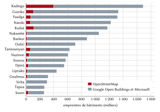
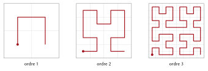
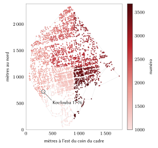
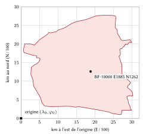

# Introduction

## Le problème

Une adresse remplit trois fonctions : elle permet à un visiteur de trouver un logement, à une institution de désigner ce logement dans ses fichiers, et au ménage de prouver où il habite. Le Burkina Faso dispose d'instruments partiels pour chacune de ces fonctions, mais d'aucun qui les assure toutes pour chaque ménage. La Poste Burkina Faso attribue un code postal à cinq chiffres à chaque commune et à des zones de distribution dans les deux plus grandes villes [@upu2021bfa; @laposte_cp]. Les communes de Ouagadougou et de Bobo-Dioulasso ont des rues codifiées et renumérotent les portes avec l'appui de l'Association des municipalités du Burkina Faso (AMB) et de l'Union européenne [@b24_2021; @sidwaya2023; @b24_2025]. Le cadastre numérote les parcelles par section, îlot et parcelle [@decret2012_1006]. Aucun de ces systèmes n'atteint la concession, l'unité dans laquelle vit la plupart des ménages burkinabè : une cour, murée ou ouverte, qui réunit derrière une même entrée la maison principale, des chambres, une cuisine et un grenier.

Chacun en connaît les conséquences. Une livraison se termine par un appel téléphonique et une suite de repères. Un moto-taxi ou une ambulance atteint le bon quartier, puis perd du temps dans des ruelles sans nom. Dans les zones non loties de Ouagadougou, où vivent plus de 30 % des habitants de la ville [@afd2021], rien n'est numéroté. Dans les villages, les cases rondes d'une concession familiale se dressent au milieu des champs, sans route entre elles. Les familles établies à l'étranger envoient de l'argent et des biens à des concessions qui n'ont aucune adresse écrite.

## Contribution

Ce rapport décrit un modèle d'adressage conçu pour le Burkina Faso et le registre émis selon ce modèle. Ses apports sont les suivants :

1. une forme de code, *nom + numéro*, où le nom est un nom de quartier ou de village déjà en usage et le numéro compte au plus cinq chiffres, unique à l'échelle nationale sans commune ni région (section 4) ;
2. un schéma de numérotation, un bloc figé par aire au sein d'une plage nationale par nom, ordonné le long d'une courbe de Hilbert avec des réserves, qui garde les codes stables à mesure que le pays grandit (sections 4.6 à 4.8) ;
3. un registre complet de 8 369 987 concessions, regroupées à partir de 13 318 641 empreintes de bâtiments, accompagné d'une spécification normative, d'un moteur de référence, de vecteurs de conformité et d'un serveur prêt à déployer (section 5) ;
4. la mesure des propriétés des codes émis (section 6) et la comparaison avec les variantes que nous avons évaluées (section 7) ;
5. une estimation des bénéfices pour les citoyens, la logistique, les secours et l'administration, chacune avec ses hypothèses et une plage de sensibilité (sections 8 à 11).

Le modèle est conçu pour fonctionner à côté des systèmes officiels, jamais contre eux. Là où une commune a donné une adresse, celle-ci s'affiche en premier, telle que la commune l'écrit ; le code postal de La Poste forme le début de chaque forme machine ; les références cadastrales sont conservées comme renvois.

## Plan du rapport

La section 2 passe en revue les systèmes d'adressage, postaux et fonciers existants et la littérature internationale. La section 3 décrit les données, la section 4 expose le modèle règle par règle, la section 5 sa mise en œuvre et la section 6 son évaluation. La section 7 présente les variantes écartées. Les sections 8 à 11 évaluent les bénéfices par secteur. La section 12 traite de la protection des données, de la sécurité et de la gouvernance, la section 13 des limites, et la section 14 conclut.

# Contexte et travaux existants

## Le pays

Le cinquième recensement général (RGPH 2019) a dénombré 20 505 155 habitants répartis en 3 908 847 ménages, soit 5,2 personnes par ménage ; 73,9 % vivaient en milieu rural [@insd2022key]. Ouagadougou comptait 2 415 266 habitants et Bobo-Dioulasso 904 920 [@insd2022]. Une réforme adoptée en Conseil des ministres le 2 juillet 2025 a remplacé les 13 régions et 45 provinces par 17 régions et 47 provinces aux noms nouveaux ; les 351 communes, dont 49 urbaines et 302 rurales, n'ont pas changé [@koaci2025]. La révision constitutionnelle promulguée en janvier 2024 a fait des langues nationales les langues officielles, le français et l'anglais devenant langues de travail [@b24_constitution] ; le mooré, le dioula, le fulfulde et le gulmancema sont chacun parlés par des millions de personnes. Les numéros de téléphone comptent huit chiffres et se lisent par paires.

## Les codes postaux

La fiche d'adressage de l'Union postale universelle pour le Burkina Faso place un code postal à cinq chiffres devant le nom de la localité, comme dans *10010 OUAGADOUGOU* [@upu2021bfa]. Le service de La Poste en décrit la structure : le premier chiffre désigne la région, les deux premiers la province, le troisième et le quatrième le quartier, la commune, la ville ou l'agence, et le cinquième le type (0 pour une commune ou un quartier, 1 à 8 pour une agence) [@laposte_cp]. Nous avons relevé la table publique complète : 582 codes, dont 351 codes de commune, 122 codes de quartier (66 noms de quartiers dans six zones de Ouagadougou et 56 dans quatre zones de Bobo-Dioulasso) et 109 codes d'agence. Le chiffre de région suit encore le découpage antérieur à 2025. Le code postal désigne une commune ou une zone, jamais une rue ni une porte, et la table n'est pas publiée en données ouvertes. Une commune, Komsilga (Kadiogo), n'y figure pas.

## Codes de rues et numéros de porte

Ouagadougou et Bobo-Dioulasso ont été adressées pour la première fois en 1985 [@sidwaya2022]. Le redécoupage de 2009 a porté Ouagadougou de 30 à 55 secteurs et Bobo-Dioulasso de 25 à 33, ce qui a rompu l'ancienne numérotation. Un code de rue associe le numéro du secteur et un numéro d'ordre (« Rue 54.160 ») ; les numéros de porte sont métriques et alternent d'un côté à l'autre de la rue. En novembre 2021, l'AMB et l'Union européenne ont lancé la rénovation de l'adressage urbain des deux villes, qui devait référencer plus de 16 000 rues et numéroter gratuitement chaque habitation [@b24_2021]. En octobre 2023, le Projet d'appui au système d'information urbaine (PASIU) faisait état de plus de 16 000 rues et 93 000 portes adressées [@sidwaya2023] ; en avril 2025, Ouagadougou a étendu l'opération aux arrondissements 5 et 12, soit plus de 2 277 rues et 43 000 portes [@b24_2025]. Nous n'avons trouvé ni service public de recherche ni données ouvertes pour ces adresses. Dans OpenStreetMap, 1 571 rues nommées des deux villes portent leur code communal.

## Les secteurs

Les citadins désignent leur *secteur* (« secteur 15 »), mais aucune carte des limites des secteurs n'est publique. Nous n'en avons trouvé ni dans OpenStreetMap, ni sur la Humanitarian Data Exchange ou geoBoundaries (qui ne contiennent que les communes), ni sur les sites des communes ou de l'Institut national de la statistique et de la démographie (INSD), qui publie la liste des secteurs et leur population, sans limites. Un code fondé sur les secteurs ne pourrait donc pas être calculé de manière reproductible, et une limite devinée placerait des logements dans le mauvais secteur.

## Les parcelles

Le décret 2012-1006 numérote les parcelles cadastrales par section, îlot et parcelle, en chiffres uniquement [@decret2012_1006]. Au 31 décembre 2022, la Direction générale des Impôts avait numérisé 434 274 parcelles sur environ 1 263 068 [@dgi2023], et elle a lancé en mars 2025 la plateforme SYC@D pour les procédures cadastrales et foncières [@b24_sycad]. La parcelle identifie un droit foncier, non le point où arrive un visiteur, et les zones non loties n'en ont pas. Nous ne l'utilisons que comme renvoi.

## La pratique internationale

La norme S42 de l'UPU définit les éléments des adresses postales et les gabarits de leur présentation [@upu2017s42], et l'UPU soutient qu'une adresse conditionne l'identité sociale et juridique ainsi que l'accès aux services publics [@upu2012addressing] ; sa récente analyse économétrique des données postales montre qu'une meilleure précision des adresses accroît les premières tentatives de distribution réussies de 5,4 % en médiane, et jusqu'à 23 % [@upu2025brief]. L'étude de la Banque mondiale sur l'adressage des villes africaines a documenté des programmes de dénomination des rues et de numérotation des portes, pour un coût moyen de 5,7 \$ US par porte aux prix de 2005, et constaté que ces systèmes se dégradent lorsque les habitants ne s'en servent pas [@farvacque2005]. ONU-Habitat a souligné le rôle du réseau des rues dans la prospérité urbaine [@unhabitat2013]. Ces programmes supposent des rues ; or une grande partie de l'habitat burkinabè se trouve dans des villages et des zones non loties où la rue n'est pas un repère utilisable.

## Codes de grille et codes de mots

Les codes de grille se passent entièrement des rues. Open Location Code (Plus Codes) code la latitude et la longitude dans un alphabet de base 20, par exemple *7C4W9F7M+M89* [@olc] ; what3words attribue trois mots du dictionnaire à chaque carré de 3 m [@what3words]. Dans la région, le système national d'adressage numérique des propriétés du Ghana, lancé en 2017, attribue un code à chaque emplacement à partir d'une grille nationale [@ghanapost2017]. Les codes de grille sont précis et se passent de registre, mais ils désignent un point plutôt qu'un logement, changent quand le point choisi se déplace, et leurs alphabets ne sont pas des mots employés par les habitants : un Plus Code oblige à épeler des lettres, ce qui est source d'erreurs en français comme dans les langues nationales, et les codes de mots dépendent d'un dictionnaire propriétaire. Notre modèle conserve un code de grille, le code de point de la section 4.11, pour les lieux qui ne sont pas des logements, mais fonde l'adresse sur des noms que les gens disent déjà.

## Principes de conception

De cet examen nous avons tiré dix principes, par ordre de priorité :

1. on retient le code et on l'obtient sans effort : un nom familier et au plus cinq chiffres ;
2. le code est unique dans tout le pays à lui seul, sans commune, secteur ni position ;
3. l'unité est la concession, et la navigation s'arrête à son portail ;
4. une adresse officielle passe en premier partout où elle existe ;
5. le code ne peut pas être confondu avec un code officiel : il commence par un nom et ne ressemble donc jamais à un code postal, à un code de rue (« 15.123 ») ni à une référence de parcelle ;
6. il fonctionne hors ligne ;
7. il est stable : un code ne se déplace jamais et n'est jamais réattribué ;
8. il décrit des lieux, jamais des personnes ;
9. il est ouvert et transférable à l'État ;
10. il est conçu pour les lieux, les noms et les institutions du Burkina Faso.

# Données et sources

**Empreintes de bâtiments.** Nous avons combiné 1 032 537 empreintes issues d'OpenStreetMap [@osm2026; @haklay2008] avec des empreintes extraites d'images satellitaires par Google Open Buildings [@sirko2021; @openbuildings] et par Microsoft [@msbuildings], diffusées par Overture Maps [@overture], ces dernières n'étant retenues que là où OpenStreetMap n'avait rien. On obtient 13 318 641 empreintes, d'une surface médiane de 22,6 m². La couverture d'OpenStreetMap se concentre dans le Kadiogo, où elle fournit 397 492 des 1 687 862 empreintes ; ailleurs, les empreintes issues de l'imagerie dominent (figure 2). L'attribut de hauteur de ces empreintes est une valeur d'affichage par défaut et n'est pas utilisé.

**Lieux.** Les aires de code sont amorcées à partir des points de lieu d'OpenStreetMap (ville, bourg, quartier, faubourg, voisinage, village, hameau, lieu-dit) et des lieux habités de GeoNames [@geonames], qui nomment des quartiers de Ouagadougou absents d'OpenStreetMap, comme Dapoya, Larlé ou Cissin.

**Unités administratives.** Les limites des communes proviennent du jeu de données opérationnel commun de l'OCHA de 2025, avec 17 régions, 47 provinces et 351 communes [@hdx2025] ; la figure 1 montre la densité des concessions par commune. Chaque commune a été appariée à son code postal : 294 par nom exact, 55 par variante orthographique (par exemple Goursi et *GOURCY*), une à la main (Thiou dans le Boulkiemdé, *THYOU 40850*) ; Komsilga, absente de la table de La Poste, utilise 10990, un code hors de la série de La Poste, jusqu'à ce que celle-ci lui en attribue un.

**Frontière nationale.** La frontière du pays est la limite nationale du Burkina Faso dans OpenStreetMap (`admin_level` 2) [@osm2026]. C'est elle qui décide où un code peut exister, et non les contours des communes : un bâtiment n'est codé que si son entrée se trouve à l'intérieur de la frontière ou à moins de 300 m de celle-ci, une marge pour la précision du tracé et pour les portails situés sur la ligne. Les contours de communes et les cadres de points qui débordent sur un pays voisin n'y donnent aucun code.

**Rues officielles.** Les codes de rues de Ouagadougou et de Bobo-Dioulasso proviennent d'OpenStreetMap, où 1 571 rues nommées les portent.

**Clôtures et portails.** Les murs, clôtures et haies cartographiés dans OpenStreetMap (5 868 enceintes fermées autour de bâtiments) et les portails cartographiés servent à regrouper les bâtiments et à valider ce regroupement.

{width=100%}

{width=85%}

# Le modèle

## Notations et formes d'un code

Dans tout ce qui suit, $P$ désigne le nom de plaque d'une aire, $N$ le numéro d'une concession, $d \in \{3,4,5\}$ le nombre de chiffres de $N$, $C_5$ le code postal à cinq chiffres de la commune, $I_3$ l'indice à trois chiffres de l'aire dans sa commune, $i_5$ l'indice national du nom sur cinq chiffres, et $c$ le chiffre de contrôle. Un même code a plusieurs formes (tableau 1).

| Forme | Exemple | Usage |
|:------------|:----------------------|:--------------------|
| Retenue | **Koulouba 17 76**, dite « Koulouba, dix-sept, soixante-seize » | les gens : dite, tapée, écrite sur un colis |
| Cinq chiffres | **Bobo 26 206**, dite « vingt-six, deux cent six » | les grands lieux : une paire et une centaine |
| Trois chiffres | **Abanda 217**, dite « deux cent dix-sept » | les petits villages |
| Machine | **BF-10000-V064-1776-9** | systèmes d'information ; le dernier chiffre est le contrôle |
| Bâtiment, entrée | **BF-10000-V064-1776-9.2/1** | un bâtiment de la concession ; l'un de ses portails |
| Point | **BF-10000 E1885 N1262** | n'importe quel point : un étal, un champ, une place de marché |
| Officielle | **Avenue Uemoa, Ouagadougou** | l'adresse de la commune, affichée en premier là où elle existe |

: Les formes d'un même code.

Les formes retenue et machine s'écrivent
$$
\text{retenue} = P \ \ \sigma(N), \qquad
\text{machine} = \texttt{BF-}C_5\texttt{-V}I_3\texttt{-}N\texttt{-}c,
\tag{1}
$$
où le nom de plaque et le numéro sont séparés par une espace et où $\sigma$ groupe les chiffres comme on les dit : $\sigma(217) = 217$, $\sigma(1776) = 17\;76$, $\sigma(26206) = 26\;206$. Un nom de plaque ne contient jamais de chiffre ; le numéro commence donc toujours au premier chiffre du texte. Le chiffre de contrôle $c$ (section 4.10) ne figure que dans la forme machine : personne n'a à le voir, le taper ni le dire.

## Les aires de code

La forme machine repose sur les 351 communes et leurs codes postaux. Une *aire de code* est un lieu nommé d'une commune : un lieu d'OpenStreetMap ou un lieu habité de GeoNames. Un lieu de GeoNames situé à moins de 1 km d'un lieu d'OpenStreetMap de même nom est considéré comme le même lieu, et un second lieu de même nom à moins de 300 m est écarté. On obtient ainsi 17 518 aires, dont 7 117 issues de GeoNames. Chaque empreinte $f$ est rattachée au point de lieu $a$ le plus proche dans sa propre commune, selon une métrique équirectangulaire locale [@snyder1987] :
$$
\operatorname{aire}(f) = \operatorname*{arg\,min}_{a \in \mathcal{A}(\operatorname{commune}(f))}
\Big[ (\lambda_f - \lambda_a)^2 \cos^2 \varphi_f + (\varphi_f - \varphi_a)^2 \Big],
\tag{2}
$$
où $\lambda$ et $\varphi$ sont la longitude et la latitude, les égalités étant tranchées en faveur de la plus petite clé d'aire. Sur les 17 518 aires, 17 319 contiennent des concessions. Ouagadougou compte 159 aires et 755 775 concessions, Bobo-Dioulasso 72 aires et 247 757 concessions ; la plus grande aire, Samogan à Bobo-Dioulasso, en compte 38 168. La figure 3 montre la distribution des tailles. Chaque aire est figée à la première émission : sa clé, son bloc de numéros et son *cadre*, le rectangle englobant les centres de ses empreintes, sur lequel ses numéros sont disposés.

{width=90%}

## Les concessions

Les empreintes sont regroupées en concessions avant toute numérotation, aire par aire, dans un ordre fixe de leurs identifiants stables. Seules les empreintes dont le centre se trouve à l'intérieur de la frontière nationale sont regroupées, et une concession dont le point de référence se trouve à plus de 300 m hors de la frontière ne reçoit aucun code, quel que soit le contour de commune qui la contient. Soit $\operatorname{dist}(a,b)$ la plus courte distance entre les contours des empreintes $a$ et $b$, nulle lorsqu'elles se touchent ou se chevauchent. Les règles, appliquées dans l'ordre, figurent au tableau 2.

| Règle | Condition | Effet | Confiance |
|:--------|:-------------------------|:-----------------|---------:|
| Enceinte | le centre de l'empreinte est dans un mur, une clôture ou une haie fermés et cartographiés d'au plus 6 000 m² | l'enceinte forme une concession | 0,85 |
| Annexe | une empreinte de moins de 25 m² (cuisine, douche, grenier) | rejoint l'empreinte d'au moins 25 m² la plus proche, avec $\operatorname{dist} \le 8$ m | 0,60 |
| Groupe de cases | hors de Ouagadougou et de Bobo-Dioulasso : des cases de moins de 40 m² rattachées à aucune maison, $\operatorname{dist} \le 3$ m | une concession d'au plus 25 cases | 0,50 |
| Isolé | tout le reste | une concession à lui seul | 0,40 |

: Règles de regroupement des empreintes en concessions.

Seules les annexes rejoignent une maison, et un groupe de cases ne réunit jamais deux maisons : les regroupements ne peuvent donc pas s'enchaîner d'un bout à l'autre d'un quartier. La distance de 8 m pour les annexes tient compte de la largeur des cours burkinabè. On obtient 8 369 987 concessions, soit 1,59 empreinte par concession : 5 374 878 bâtiments isolés, 2 218 591 maisons avec leurs annexes, 767 915 groupes de cases et 8 603 enceintes. Par taille, 5 377 425 concessions ont un bâtiment, 1 842 263 deux, 685 968 trois et 464 331 quatre ou plus. Le tableau 3 donne les effectifs par région.

| Région | Concessions | Empreintes | Empreinte médiane (m²) |
|:--|--:|--:|--:|
| Kadiogo | 1 120 464 | 1 687 862 | 28,3 |
| Guiriko | 880 516 | 1 330 983 | 26,2 |
| Nando | 748 195 | 1 222 489 | 20,5 |
| Yaadga | 729 231 | 1 318 518 | 21,7 |
| Kuilsé | 680 737 | 1 174 896 | 18,8 |
| Nakambé | 633 367 | 1 050 946 | 22,3 |
| Bankui | 566 039 | 879 268 | 24,7 |
| Oubri | 443 496 | 710 452 | 18,4 |
| Tannounyan | 395 808 | 628 139 | 22,6 |
| Djôrô | 391 464 | 549 894 | 27,1 |
| Nazinon | 370 589 | 605 364 | 18,0 |
| Sourou | 367 683 | 571 327 | 24,3 |
| Liptako | 304 605 | 442 333 | 22,6 |
| Goulmou | 204 651 | 317 352 | 19,6 |
| Sirba | 193 650 | 303 459 | 18,0 |
| Tapoa | 173 993 | 264 888 | 17,7 |
| Soum | 165 499 | 260 471 | 20,0 |
| **Burkina Faso** | **8 369 987** | **13 318 641** | **22,6** |

: Concessions et empreintes par région.

## Les noms de plaque

Le nom inscrit dans un code doit être assez court pour être dit, retenu et peint sur un portail. Un nom $s$ est admis comme nom de plaque si
$$
|\operatorname{NFC}(s)| \le 12, \qquad
\big|\operatorname{mots}(s) \setminus L\big| \le 2, \qquad
s \text{ ne contient aucun chiffre},
\tag{3}
$$
où $|\cdot|$ compte les caractères après normalisation Unicode (une lettre accentuée, une espace, un trait d'union ou une apostrophe comptent chacun pour un) et où $L$ est l'ensemble des mots de liaison non comptés : de, du, des, d, la, le, les, l, et, sur, en, au, aux, à et n. Un nom qui ne satisfait pas l'équation (3) est raccourci par étapes fixes, la première qui aboutit étant retenue :

1. une forme courte d'usage documentée : les points de lieu nommés Bobo-Dioulasso et Fada N'Gourma deviennent *Bobo* et *Fada* ;
2. le nettoyage : suppression du texte entre parenthèses et des mots génériques Q, Quartier, Cité, Lotissement, Zone, Secteur, Village de et Hameau (« Q Tangonkin » devient *Tangonkin*) ;
3. l'abréviation de « Saint » en « St » ;
4. la suite de mots entiers la plus distinctive, retenue seulement lorsqu'elle l'emporte nettement sur les autres.

Un mot n'est jamais coupé, et un qualificatif qui distingue un hameau de son village d'origine (Peulh, Foulbé, Mossi, Yiri, Tenga, Naba) ne devient jamais un nom à lui seul. Lorsque la forme courte contiendrait un chiffre, se réduirait à un mot générique ou serait la forme courte d'une autre ville, l'aire prend provisoirement le nom de sa commune et le choix revient à la commune. Deux quartiers de Ouagadougou portent leur nom sans son nombre : *Ouaga* pour Ouaga 2000 et *Logements* pour 1200 Logements ; les noms complets restent des alias.

| Dérivation du nom de plaque | Aires |
|:--|--:|
| Nom officiel repris tel quel | 14 557 |
| Nettoyé | 1 767 |
| Réduit à ses mots distinctifs | 242 |
| Nommé sans son nombre | 4 |
| Forme courte documentée | 2 |
| Abrégé | 1 |
| Provisoire, laissé au choix de la commune | 945 |
| **Total** | **17 518** |

: Dérivation des noms de plaque.

Parmi les noms officiels, 1 346 dépassent 12 caractères ou deux mots. Les 945 noms provisoires couvrent 387 212 codes ; 270 d'entre eux dépassent encore la limite, pour la plupart des mots uniques très longs. Le nom officiel reste un alias (805 alias sont conservés ; 8 sont écartés parce que deux noms de plaque les revendiqueraient), si bien que la saisie du nom complet retrouve la même concession.

## La clé de nom

Des noms écrits différemment mais prononcés de la même façon doivent partager une même plage de numéros, faute de quoi deux aires émettraient le même code retenu. La clé de nom est la composition
$$
\kappa(s) = \operatorname{squeeze} \circ \operatorname{fold} \circ \operatorname{join} \circ \operatorname{article} \circ \operatorname{head} \circ \operatorname{saint} \circ \operatorname{upper} \circ \operatorname{unaccent}\,(s),
\tag{4}
$$
dont les étapes sont détaillées au tableau 5.

| Étape | Règle | Exemple |
|:----------|:---------------------------|:--------------------|
| unaccent, upper | accents et casse supprimés | Douré → DOURE |
| saint, head, article | St, Ste → Saint, Sainte ; Q, Quartier, Hameau, Village de et le, la, les, l' initiaux supprimés | Q-Tanghin → TANGHIN |
| join | tout caractère autre que A–Z et 0–9 supprimé | Saint-Camille → SAINTCAMILLE |
| fold | tch → c, dj → j, gh → g, ph → f, ou → u, w → u, gu devant i ou e → g | Ouatinoma, Watinoma → UATINOMA ; Tanguin, Tanghin, Tangin → TANGIN |
| squeeze | une lettre doublée écrite une fois ; chiffres jamais réduits | Wattinooma → UATINOMA |

: Les étapes de la clé de nom.

Le repliement ne peut que réunir des graphies, jamais scinder un nom ; une fusion abusive est sans conséquence, car les noms fusionnés se décodent encore séparément grâce à leurs blocs (section 4.6). Les 17 518 aires portent 12 344 clés distinctes, dont 2 755 sont partagées par 7 929 aires. Les plus répétées sont Natenga (74 aires), Boussouma (50), Douré (43), Tanghin (38) et Yargo (37).

## Une plage nationale par nom

Chaque clé de nom possède une plage nationale de numéros d'un nombre fixe de chiffres $d$ : 100–999, 1000–9999 ou 10000–99999. Soient $n_1, \dots, n_k$ les concessions à l'émission des aires qui partagent une clé, dans l'ordre figé de leurs clés (code postal, puis indice d'aire). Chaque aire reçoit un bloc de
$$
B(n) = \max\!\Big(20,\; 10 \left\lceil \tfrac{2n}{10} \right\rceil\Big)
\tag{5}
$$
numéros, soit le double de ses concessions arrondi à la dizaine supérieure. Le total du nom est $T = \sum_{j=1}^{k} B(n_j)$, et son nombre de chiffres est le plus petit $d$ qui laisse libre le dixième supérieur de la plage :
$$
d = \min \big\{ d' \in \{3,4,5\} : T \le \lfloor 0{,}9 \cdot 9 \cdot 10^{d'-1} \rfloor \big\},
\tag{6}
$$
c'est-à-dire $T \le 810$, $8\,100$ ou $81\,000$. Les blocs sont placés bout à bout à partir de $10^{d-1}$.

*Exemple : Koulouba.* Une aire de Ouagadougou de 2 683 concessions. L'équation (5) donne $B = 10\lceil 5366/10 \rceil = 5370$ : le bloc est 1000–6369. Comme $810 < 5370 \le 8\,100$, l'équation (6) donne quatre chiffres, et 6370–9999 restent en réserve.

*Exemple : Bobo.* L'aire centrale de Bobo-Dioulasso compte 20 007 concessions : $B = 40\,020$, le bloc est 10000–50019 et le nom a cinq chiffres, 50020–99999 restant en réserve.

*Exemple : Natenga.* Les 74 aires nommées Natenga demandent $T = 19\,260$ numéros, plus de 8 100 : le nom a cinq chiffres et occupe 10000–29259, en laissant 70 740 en réserve. *Natenga 10 016* se trouve dans le bloc de Pabré (10000–10269) et *Natenga 10 286* dans celui de Dapélogo (10270–11319) : le numéro seul désigne le lieu.

La figure 4 montre un nom partagé à quatre chiffres, Kombissiri, dont les six aires occupent 7 910 des 8 100 numéros permis, ainsi que l'organisation interne du bloc de Koulouba.

{width=100%}

| Chiffres | Aires | Concessions | Part des concessions |
|:--|--:|--:|--:|
| 3 | 8 477 | 1 301 260 | 15,5 % |
| 4 | 7 352 | 4 451 135 | 53,2 % |
| 5 | 1 490 | 2 617 592 | 31,3 % |

: Nombre de chiffres du numéro, par aire et par concession.

Aucun nom n'a besoin d'un qualificatif et aucune aire n'a dû être scindée. La plage partagée la plus remplie, celle des onze aires de Kaya, utilise 69 550 de ses 81 000 numéros, et la plus grande aire, Samogan, 76 340. Une nouvelle aire portant un nom existant, ou une aire dont le bloc est plein, reçoit le bloc suivant au-dessus de tous les blocs de son nom ; les blocs ne se déplacent, ne rétrécissent ni ne sont jamais renumérotés.

## La numérotation dans une aire

Les concessions sont numérotées le long d'une courbe de Hilbert [@hilbert1891] posée sur le cadre figé de l'aire $(x_0, y_0, x_1, y_1)$, au point de référence de chaque concession (le centre de son plus grand bâtiment, tant qu'aucun portail n'est confirmé). La courbe de Hilbert préserve mieux la proximité que les balayages ligne par ligne ou en Z [@moon2001] : des concessions voisines reçoivent des numéros voisins (figure 5). Avec $m = 16$ et $M = 2^m - 1 = 65\,535$, les coordonnées entières de la grille sont
$$
g_x = \min\!\Big(M, \Big\lfloor \frac{\lambda - x_0}{x_1 - x_0} M \Big\rfloor\Big), \qquad
g_y = \min\!\Big(M, \Big\lfloor \frac{\varphi - y_0}{y_1 - y_0} M \Big\rfloor\Big),
\tag{7}
$$
bornées inférieurement à zéro. La position $h$ sur la courbe se calcule en parcourant les échelles $s = 2^{m-1}, 2^{m-2}, \dots, 1$, avec $h$ initialement nul :
$$
r_x = \lfloor g_x / s \rfloor \bmod 2, \quad
r_y = \lfloor g_y / s \rfloor \bmod 2, \quad
h \leftarrow h + s^2 \big( (3 r_x) \oplus r_y \big),
\tag{8}
$$
où $\oplus$ est le ou exclusif bit à bit ; après chaque étape, si $r_y = 0$, le quadrant est réfléchi, $(g_x, g_y) \leftarrow (M - g_x, M - g_y)$ lorsque $r_x = 1$, puis les coordonnées sont échangées, $(g_x, g_y) \leftarrow (g_y, g_x)$.

{width=90%}

Les $n$ concessions d'une aire dont le bloc est $[F, F + B)$ sont triées selon $(h, \text{identifiant stable})$, et la $i$-ème, en comptant à partir de zéro, reçoit
$$
N_i = F + i \cdot \delta, \qquad
\delta = \max\!\Big(1, \Big\lfloor \frac{\mu}{\lfloor 1{,}5\, n \rfloor} \Big\rfloor\Big), \qquad
\mu = \Big\lfloor \frac{2B}{3} \Big\rfloor,
\tag{9}
$$
si bien que les numéros occupent la partie principale $[F, F + \mu)$, avec des écarts de $\delta - 1$ entre voisins pour les constructions intercalées, et que la *réserve de fin* $[F + \mu, F + B)$ reste vide à la première émission.

*Exemple : Koulouba 17 76.* Le point de référence de la concession est $\varphi = 12{,}3641615$, $\lambda = -1{,}5166371$, et le cadre de Koulouba est
$$
(x_0, y_0, x_1, y_1) = (-1{,}519638 ;\ 12{,}357614 ;\ -1{,}502982 ;\ 12{,}379197).
$$
L'équation (7) donne alors
$$
g_x = \Big\lfloor \frac{0{,}0030009}{0{,}016656} \cdot 65\,535 \Big\rfloor = 11\,807, \qquad
g_y = \Big\lfloor \frac{0{,}0065475}{0{,}021583} \cdot 65\,535 \Big\rfloor = 19\,880,
$$
et l'équation (8) donne $h = 906\,489\,237$, au 777ᵉ rang des 2 683 concessions le long de la courbe ($i = 776$). Avec $B = 5370$, l'équation (9) donne $\mu = 3580$, $\delta = \max(1, \lfloor 3580 / 4024 \rfloor) = 1$ et $N = 1000 + 776 = 1776$ ; la réserve de fin est 4580–6369. La figure 6 montre le résultat pour toute l'aire.

{width=68%}

## Les nouvelles concessions

Une concession bâtie après l'émission est rattachée à l'aire du code émis le plus proche dans un rayon de 250 m, sinon à l'aire qui contient le point, sinon à l'aire la plus proche. Un point situé à plus de 300 m hors de la frontière nationale ne reçoit aucun code, et aucune entrée n'y est déplacée. Soit $a$ le numéro de son prédécesseur sur la courbe (la dernière concession émise dont $h$ précède ou égale le sien) et $b$ celui de son successeur. Avec $\Phi = \{ x \in (a, b) \cap [F, F+\mu) : x \text{ libre} \}$ l'ensemble des numéros libres de la partie principale strictement compris entre eux, elle reçoit
$$
N^{*} =
\begin{cases}
\operatorname*{arg\,min}_{x \in \Phi} \big( |x - \tfrac{a+b}{2}|,\ x \big) & \text{si } \Phi \ne \varnothing,\\
\min \{ x \in [F + \mu, F + B) : x \text{ libre} \} & \text{sinon,}
\end{cases}
\tag{10}
$$
c'est-à-dire le numéro libre le plus proche du milieu (le plus petit en cas d'égalité), ou à défaut le plus petit numéro libre de la réserve de fin ; un bloc plein reçoit un bloc d'extension de son nom. À Koulouba, $\delta = 1$ : une maison bâtie entre deux voisines reçoit *Koulouba 45 80*, le premier numéro de la réserve de fin ; là où les blocs sont plus spacieux, les nouveaux logements prennent un numéro entre leurs voisins. Un numéro émis n'est jamais réattribué.

## Le décodage sans contexte

Un code retenu se lit comme un nom suivi de trois à cinq chiffres, groupés ou non. Il se décode en
$$
\operatorname{décodage}(P, N) = \big\{ a : \kappa(P) \in \{\kappa(a)\} \cup \operatorname{alias}(a),\ \ |N| = d(\kappa(P)),\ \ N \in \operatorname{blocs}(a) \big\},
\tag{11}
$$
ensemble qui, par construction, a au plus un élément. Un numéro situé hors de tout bloc, dans la réserve d'un nom ou avec un mauvais nombre de chiffres est signalé comme non émis, jamais deviné. Une forme par secteur (« Secteur 15 Ouaga · 48 217 ») est refusée, avec l'invitation à donner le quartier ou le village et son numéro.

## Le chiffre de contrôle

Les systèmes d'information échangent la forme machine, dont le dernier chiffre est calculé par l'algorithme de Damm sur un quasi-groupe totalement antisymétrique d'ordre 10 [@damm2004; @damm2007]. Pour la suite de chiffres $x_1 x_2 \dots x_\ell$,
$$
c_0 = 0, \qquad c_j = Q[c_{j-1}][x_j] \quad (j = 1, \dots, \ell), \qquad c = c_\ell,
\tag{12}
$$
où $Q$ est la table ci-dessous et la chaîne contrôlée est $i_5 \,\Vert\, C_5 \,\Vert\, 2 \,\Vert\, I_3 \,\Vert\, N$ : l'indice national du nom sur cinq chiffres, le code postal, le chiffre de type d'un code d'aire, l'indice d'aire et le numéro.

| $Q$ | 0 | 1 | 2 | 3 | 4 | 5 | 6 | 7 | 8 | 9 |
|:-:|:-:|:-:|:-:|:-:|:-:|:-:|:-:|:-:|:-:|:-:|
| **0** | 0 | 3 | 1 | 7 | 5 | 9 | 8 | 6 | 4 | 2 |
| **1** | 7 | 0 | 9 | 2 | 1 | 5 | 4 | 8 | 6 | 3 |
| **2** | 4 | 2 | 0 | 6 | 8 | 7 | 1 | 3 | 5 | 9 |
| **3** | 1 | 7 | 5 | 0 | 9 | 8 | 3 | 4 | 2 | 6 |
| **4** | 6 | 1 | 2 | 3 | 0 | 4 | 5 | 9 | 7 | 8 |
| **5** | 3 | 6 | 7 | 4 | 2 | 0 | 9 | 5 | 8 | 1 |
| **6** | 5 | 8 | 6 | 9 | 7 | 2 | 0 | 1 | 3 | 4 |
| **7** | 8 | 9 | 4 | 5 | 3 | 6 | 2 | 0 | 1 | 7 |
| **8** | 9 | 4 | 3 | 8 | 6 | 1 | 7 | 2 | 0 | 5 |
| **9** | 2 | 5 | 8 | 1 | 4 | 3 | 6 | 7 | 9 | 0 |

: Table du quasi-groupe de Damm $Q$ (ligne : chiffre intermédiaire $c_{j-1}$ ; colonne : chiffre suivant $x_j$).

*Exemple.* L'indice national de Koulouba est 5572, son code postal 10000 et son indice d'aire 064 : la chaîne contrôlée est 05572 10000 2 064 1776. Les chiffres intermédiaires $c_1, \dots, c_{18}$ valent 0, 9, 3, 4, 2, 2, 4, 6, 5, 3, 5, 3, 3, 9, 5, 5, 5, 9 ; donc $c = 9$ et la forme machine est BF-10000-V064-1776-9. Remplacer 1776 par l'inversion 1767 donne le contrôle 7, et par l'erreur simple 1777 le contrôle 5 : les deux sont refusés. Comme l'indice du nom, la commune et l'aire entrent dans le contrôle, un numéro transposé dans une autre aire du même nom échoue à la fois au contrôle et au test de bloc.

## Les codes de point

Tout point, y compris un lieu qui n'est pas un logement, a un code de point : le code postal de la commune suivi de sa distance à l'est et au nord de l'origine figée de la commune $(\lambda_0, \varphi_0)$, en unités de 10 m, sur quatre chiffres par axe (cinq lorsque la commune dépasse 99,99 km). Avec $\varphi_c$ la latitude de référence de la commune,
$$
\begin{aligned}
k_x &= 111\,320 \cos \varphi_c, & k_y &= 110\,574,\\
E &= \Big\lfloor \frac{(\lambda - \lambda_0)\, k_x}{10} \Big\rfloor, & N_s &= \Big\lfloor \frac{(\varphi - \varphi_0)\, k_y}{10} \Big\rfloor,
\end{aligned}
\tag{13}
$$
où $k_x$ et $k_y$ sont les mètres par degré de longitude et de latitude. Le code se décode au centre de sa cellule de 10 m ; l'erreur de décodage est donc bornée par la demi-diagonale de la cellule :
$$
\varepsilon \le \tfrac{1}{2} \sqrt{10^2 + 10^2} \approx 7{,}07 \text{ m}.
\tag{14}
$$

*Exemple.* Pour le point de Koulouba 17 76 dans le cadre de Ouagadougou ($\lambda_0 = -1{,}69$, $\varphi_0 = 12{,}25$, $\varphi_c = 12{,}38$) : $k_x = 111\,320 \cos 12{,}38^\circ = 108\,731{,}5$, $E = \lfloor 0{,}1733629 \cdot 108\,731{,}5 / 10 \rfloor = \lfloor 1885{,}00 \rfloor = 1885$ et $N_s = \lfloor 0{,}1141615 \cdot 110\,574 / 10 \rfloor = \lfloor 1262{,}33 \rfloor = 1262$, d'où BF-10000 E1885 N1262 (figure 7). Le Burkina Faso s'étend sur deux fuseaux UTM ; c'est pourquoi chaque commune a son propre cadre local plutôt qu'une grille nationale projetée. Sur les 351 cadres, 346 tiennent sur quatre chiffres dans les deux axes.

{width=55%}

*Points hors de tout contour.* Les contours de communes publiés sont simplifiés et ne pavent pas exactement le pays : 9 235 entrées émises (0,11 %, dans 110 communes) tombent dans un interstice entre deux contours ou juste au-delà d'une frontière. Les cadres ne bougent jamais ; un tel point est donc codé dans le cadre d'une commune, choisie parmi les candidates $\mathcal{C}$ : les communes dont le contour se trouve à moins de 10 km du point et dont le cadre est dépassé d'au plus 300 cellules (3 000 m). En comparant dans cet ordre,
$$
c^\ast = \operatorname*{arg\,min}_{c \in \mathcal{C}} \big( h_c,\; d_c,\; p_c \big),
$$
où $h_c$ vaut 0 lorsque le cadre de $c$ contient le point et 1 sinon, $d_c$ est la distance du point au côté le plus proche du contour de $c$, les écarts de longitude multipliés par $\cos \varphi$ (un polynôme fixe, pour que tout portage choisisse la même commune), et $p_c$ le code postal, qui départage les égalités. Un point situé au-delà du cadre de $c^\ast$ prend la cellule de bord la plus proche, $E$ et $N_s$ ramenés dans $[0, 10^{k} - 1]$ pour $k$ chiffres ; un point sans candidate est refusé. Un code de point est une référence de grille : un point juste au-delà de la frontière en a un, jamais un code de concession. Les deux limites couvrent le registre avec une marge : l'entrée émise la plus éloignée se trouve à 8,57 km d'un contour, et la cellule de bord la plus éloignée à 140 m au-delà de son cadre. Sur les 9 235 entrées, 9 227 sont codées dans un cadre qui les contient, dans la borne de l'équation (14), et 8 dans une cellule de bord, décodées à au plus 140 m ; le registre garde l'entrée exacte à côté du code. Le décodage utilise le cadre de la commune que nomme le code, qui peut différer de la commune du code de concession.

*Exemple.* L'entrée de BF-10000-V076-11657-0, une concession de Ouagadougou, tombe dans l'interstice entre les contours de Ouagadougou (à 5,1 m) et de Komsilga (à 0,7 m). Les deux cadres la contiennent ; le contour plus proche de Komsilga donne BF-10990 E2012 N2633. L'entrée de Tangassoko 23 02, à 10,9987819 N, −0,9736617, se trouve à 236 m du contour de Tiebele, au sud de tous les cadres à moins de 10 km. Dans le cadre de Tiebele ($\varphi_0 = 11{,}00$), $N_s = \lfloor (10{,}9987819 - 11{,}00) \cdot 110\,574 / 10 \rfloor = -14$, soit 14 cellules au-delà : elle prend la cellule de bord $N_s = 0$, BF-32250 E1052 N0000.

## Le profil des bâtiments

Chaque bâtiment porte une classe d'usage avec sa confiance et sa source, sa taille, son nombre de niveaux lorsqu'il est connu et un statut. Les classes sont : résidentiel (cour familiale, villa, chambres en location, immeuble, case ronde, grenier), commerce (boutique, kiosque, marché), bureau, administration, enseignement, santé, culte, industrie, hébergement, transport, agriculture, annexe, chantier et ruine. Les classes sont déduites selon un ordre fixe d'indices : le type de bâtiment d'OpenStreetMap (confiance 0,85), une étiquette de commerce, d'équipement ou de bureau sur l'empreinte (0,75), un lieu cartographié dans l'empreinte (0,65), la taille de l'empreinte (0,30 à 0,40), et à défaut résidentiel (0,45). En pratique, 13 276 492 bâtiments sont résidentiels, presque tous par défaut ; 18 187 sont des annexes, 7 081 des établissements d'enseignement, 5 610 des commerces, 4 370 des chantiers, 2 872 des lieux de culte, 1 435 des établissements de santé et 1 103 des bureaux. OpenStreetMap indique le nombre de niveaux de 511 bâtiments. Un logement ne porte jamais de nom.

## L'adresse officielle d'abord

Là où l'État ou une commune a donné une adresse, celle-ci s'affiche en premier, telle qu'elle est écrite. À Ouagadougou et à Bobo-Dioulasso, la rue officielle située à moins de 30 m de la concession s'affiche sur 143 381 concessions (« Avenue Uemoa, Ouagadougou »). Un numéro de porte du plan communal, une fois connu par les données de la commune ou lu sur la plaque par les habitants, remplace la rue. Le code N-Ways ne change jamais et se place à côté de l'adresse officielle : il sert au téléphone et distingue les ménages d'une même cour. Partout ailleurs, aucune adresse officielle n'existe au niveau de la porte, et le code N-Ways est l'adresse.

# Mise en œuvre

## Spécification et moteur de référence

La spécification normative (`engine/SPEC.md`) définit toutes les règles qui précèdent. Le moteur de référence (`engine/reference/bf_engine.py` et `plate_names.py`) les met en œuvre avec la seule bibliothèque standard de Python : clés de nom, noms de plaque, chiffres de contrôle, formes machine et retenue, codes de point, recherche de la commune, regroupement des concessions, ordre de Hilbert et numérotation. Il embarque le registre figé des aires (`engine/data/register.json`) et les contours des communes : un décodeur n'a besoin d'aucune connexion réseau.

## Vecteurs de conformité

Tout portage du moteur doit reproduire `engine/reference/vectors.json` : 722 clés de nom, 500 formes retenues et machine, 2 394 décodages de codes réels, 700 codes de point, 621 points hors de tout contour de commune, cinq positions de Hilbert, six cas de regroupement et un scénario de numérotation de 41 concessions de Samogan suivies de 60 insertions selon l'équation (10). Un second fichier, `test_vectors.json`, couvre les chiffres de contrôle, les saisies refusées, les formes dites en français et les noms de plaque.

## Le registre

Le registre (`registry/`) publie tous les codes émis, sans rien retenir : un fichier CSV compressé par commune (351 fichiers), la table figée des aires `areas.csv.gz` et `MANIFEST.json`, qui donne l'effectif et l'empreinte SHA-256 de chaque fichier décompressé. Chaque ligne porte les formes machine, retenue et écrite, l'aire, le numéro et son contrôle, le statut et la date d'émission, le point d'entrée et sa nature, le code de point, l'adresse officielle lorsqu'elle existe et le profil du bâti (classe, usage, nature, nombre de bâtiments, surface de plancher, règle de regroupement). Il ne contient aucune donnée personnelle (section 12).

## Serveur et API

Le répertoire `server/` contient un service HTTP prêt à déployer, écrit avec la seule bibliothèque standard de Python et réutilisant le moteur de référence. Son import vérifie l'empreinte et l'effectif de chaque fichier par rapport au manifeste, construit une base SQLite avec ses index et un index spatial, et refuse toute discordance ; son export réécrit le registre, et un export après import est identique octet pour octet aux fichiers publiés une fois décompressés. L'API JSON sous `/v1` répond aux recherches par code machine, par forme retenue (quels que soient les espaces, la casse ou les accents), par adresse officielle et par code de point ; elle renvoie la concession située en un point et les codes voisins, valide les codes, code et décode les codes de point, et liste les zones et les aires. Un déploiement désigné comme émetteur peut émettre des codes pour de nouvelles concessions et d'autres portes selon les règles de la section 4.8 : aucun code à moins de 3 m d'un code existant, des contours entre 6 m² et 2 ha, d'autres portes à moins de 80 m, et l'aire du code le plus proche dans un rayon de 250 m ; rien à plus de 300 m hors de la frontière nationale. Une image de conteneur fait de `docker compose up` l'ensemble du déploiement. L'API est documentée avec des réponses réelles dans `docs/api.md` et par une description OpenAPI 3.1.

## Parité avec l'émetteur

Nous avons vérifié que le serveur émet exactement ce qu'émet l'émetteur N-Ways. Le rejeu de 105 étapes d'émission, comprenant des portes qui remplissent un bloc, sa réserve de fin et un bloc d'extension, a donné à chaque étape des numéros, des formes machine et écrites, des codes de point et des blocs identiques ; les 60 vecteurs d'insertion font partie des tests du serveur. Sur le registre complet, 50 codes tirés au hasard concordaient avec le service N-Ways sur les 21 champs comparés.

# Évaluation

Nous avons mesuré le registre émis avec le moteur publié et le script d'évaluation du dépôt, `tools/paper-evaluation.py`. Le tableau 8 résume les résultats.

**Unicité et collisions évitées.** Les 3 694 477 codes dont le nom est partagé par plusieurs aires sont ceux qui risquent l'ambiguïté. Si chaque aire avait numéroté sa propre plage à partir de $10^{d-1}$, avec les mêmes règles de bloc et de pas, 1 600 311 d'entre eux (43,3 %) auraient partagé leur forme retenue avec un code d'une autre aire du même nom. Avec les plages nationales, ce nombre est nul par construction.

**Détection des erreurs.** Les taux observés sont ceux que prévoit la théorie du quasi-groupe de Damm : toutes les substitutions d'un chiffre et toutes les inversions de chiffres voisins sont détectées [@damm2007], soit les deux classes d'erreurs qui dominent dans la transcription manuelle de codes décimaux [@verhoeff1969] ; les erreurs jumelles et les inversions à distance, plus rares, sont détectées environ neuf fois sur dix.

**Longueur.** Le nombre de chiffres est celui du tableau 6. Un numéro d'au plus cinq chiffres reste dans les limites de la mémoire à court terme décrites par la littérature en psychologie, qui la situe autour de quatre unités pour des éléments sans lien entre eux [@miller1956; @cowan2001] ; groupé en une paire et une centaine, un numéro de cinq chiffres ne forme plus que deux ou trois unités.

**Regroupement des concessions.** Nous avons rejoué les règles de regroupement en masquant les 5 868 murs, clôtures et haies cartographiés, puis comparé le résultat aux enceintes : 11,7 % des enceintes sont retrouvées entières, 9,7 % exactement, et 35,9 % de plus ne manquent qu'un bâtiment. Derrière un mur burkinabè, la maison principale, les chambres et la cuisine sont en général des bâtiments séparés ; sans mur cartographié, les règles les laissent séparés à dessein : réunir deux codes plus tard ne coûte rien, alors que défaire une fusion erronée donnerait un nouveau code à un ménage. Les confirmations des habitants dans l'application (« ces bâtiments forment un seul logement », « voici le portail ») corrigent le reste.

| Propriété | Mesure |
|:--------------|:------------------------------|
| Codes émis | 8 369 987 concessions, issues de 13 318 641 empreintes ; 17 319 des 17 518 aires portent des codes |
| Unicité des codes machine | 8 369 987 codes distincts |
| Unicité des formes retenues | 8 369 987 formes distinctes (par clé de nom et numéro) |
| Longueur du numéro | 3 chiffres : 15,5 % ; 4 chiffres : 53,2 % ; 5 chiffres : 31,3 % ; aucun plus long |
| Longueur de la forme écrite | médiane 13 caractères, 99ᵉ centile 19, maximum 23 ; 91,6 % en ont au plus 16 |
| Décodage sans contexte | 20 000 codes tirés sur 20 000 retrouvent leur forme machine, tels qu'écrits, en minuscules sans accents et sans espace dans le numéro |
| Erreurs sur un chiffre détectées | 344 655 sur 344 655 (100 %) |
| Inversions de chiffres voisins détectées | 30 453 sur 30 453 (100 %) |
| Erreurs jumelles détectées ($aa \to bb$) | 47 208 sur 52 578 (89,8 %) |
| Inversions à distance détectées ($abc \to cba$) | 25 097 sur 28 264 (88,8 %) |
| Erreur de décodage des codes de point | au plus 7,04 m dans un cadre, sur 20 000 entrées tirées (borne 7,07 m, équation (14)) |
| Ambiguïté évitée par les plages nationales | 1 600 311 codes entreraient en collision si chaque aire numérotait sa propre plage |

: Propriétés mesurées du registre émis. Les taux de détection portent sur toutes les erreurs possibles de 2 000 codes machine tirés au hasard.

**Couverture des codes de point.** Tout code a un code de point. Les 9 235 entrées (0,11 %, dans 110 communes) situées hors de tout contour de commune publié sont codées selon la règle de la section 4.11 ; 8 d'entre elles prennent la cellule de bord la plus proche d'un cadre, à au plus 139,7 m.

**Exemples sur des codes réels.** Le tableau 9 donne la concession la plus proche de lieux connus.

| Près de | Code | Forme machine | Code de point |
|:--------------|:--------------|:------------------------|:------------------|
| Aéroport de Ouagadougou | Koulouba 17 76 | BF-10000-V064-1776-9 | BF-10000 E1885 N1262 |
| Gare routière de l'Est, Ouagadougou | Wayalguin 13 21 | BF-10000-V136-1321-4 | BF-10000 E2318 N1563 |
| Marché Rood-Woko, Ouagadougou | Ouagadougou 31 493 | BF-10000-V089-31493-6 | BF-10000 E1811 N1309 |
| Centre commercial de Ouaga 2000 | Caisse 13 63 | BF-10000-V026-1363-8 | BF-10000 E1771 N0623 |
| Grand Marché, Bobo-Dioulasso | Bobo 26 206 | BF-90000-V006-26206-1 | BF-90000 E3164 N2624 |
| Cathédrale de Koudougou | Koudougou 11 485 | BF-40000-V019-11485-8 | BF-40000 E1596 N1381 |
| Cathédrale de Ouahigouya | Ouahigouya 13 699 | BF-55000-V032-13699-9 | BF-55000 E1413 N1630 |
| Musée de Kaya | Kaya 34 752 | BF-50000-V051-34752-0 | BF-50000 E2851 N0912 |
| Cathédrale de Banfora | Banfora 15 450 | BF-94000-V001-15450-3 | BF-94000 E2346 N2908 |
| Marché de Fada N'Gourma | Fada 12 600 | BF-75000-V019-12600-7 | BF-75000 E2933 N5881 |
| Marché central de Dédougou | Dédougou 14 323 | BF-80000-V013-14323-8 | BF-80000 E3041 N2576 |
| Cathédrale de Koupéla | Koupéla 20 158 | BF-72000-V021-20158-4 | BF-72000 E0940 N1694 |
| Cathédrale de Gaoua | Gaoua 22 319 | BF-96000-V033-22319-6 | BF-96000 E2156 N1742 |
| Cathédrale de Dori | Dori 14 311 | BF-60000-V042-14311-7 | BF-60000 E4054 N3171 |

: Codes réels du registre : la concession la plus proche de lieux connus. Pour les deux premières, la rue officielle s'affiche en premier (Avenue Uemoa ; Avenue Pape Jean Paul II).

Quatre situations illustrent le fonctionnement du système. *Au téléphone*, un conducteur de moto-taxi entend « Koulouba, dix-sept, soixante-seize », tape `koulouba 1776` et voit s'afficher la concession, l'avenue Uemoa et le portail. *Avec un nom partagé*, `natenga 10016` tombe dans le bloc de Pabré et `natenga 10286` dans celui de Dapélogo, sans liste à parcourir. *Avec une erreur de transcription*, le système d'un partenaire qui reçoit BF-10000-V064-1767-9 le refuse, car le contrôle de 1767 n'est pas 9. *Avec une forme par secteur*, `Secteur 15 Ouaga 48217` est refusé avec une demande de quartier, puisqu'aucune carte des secteurs ne permet de le vérifier.

# Variantes étudiées et écartées

## Arithmétique des capacités

Avant l'émission, nous avions estimé le nombre de concessions à 0,546 par bâtiment, le rapport mesuré à Ouagadougou, soit environ 7,3 millions pour le pays ; l'effectif à l'émission est de 8 369 987. La règle de capacité exige au moins deux numéros par concession. Le tableau 10 confronte à cette règle les formes évaluées.

| Variante | Exemple | Arithmétique | Résultat |
|:-----------|:-------------|:---------------|:--------------|
| Chiffres nationaux seuls | 48173052 | $8{,}37\,\text{M} \times 2 = 16{,}7\,\text{M}$, 8 chiffres | trop long ; n'indique aucun lieu |
| Commune et chiffres | 10000 · 1 538 004 | Ouagadougou $\approx 756\,000 \times 2$, 7 chiffres | trop long |
| Zone postale et chiffres | 10040 · 482 173 | zones de Ouagadougou $\approx 126\,000$ concessions, 6 chiffres | les codes de zone ne sont pas des mots que l'on dit |
| Commune et lettres | Ouaga 7HQ2X | $20^5 = 3{,}2\,\text{M}$ | des lettres à apprendre et à épeler ; peu adapté aux personnes qui lisent peu |
| Secteur et chiffres | Secteur 15 Ouaga · 48 217 | secteur moyen de Ouagadougou $\approx 13\,700$ concessions, 5 chiffres | aucune carte des secteurs (section 2.4) |
| Plus Code | 7C4W9F7M+M89 | grille mondiale, 10 à 11 caractères | lettres et signe plus ; difficile à dicter |
| Une plage par aire | Natenga 217 (×74) | section 6 : 1 600 311 codes ambigus | pas unique sans la commune |
| **Quartier ou village et numéro d'une plage nationale** | **Koulouba 17 76** | chacune des 17 518 aires tient en 5 chiffres | **retenue** |

: Formes de code confrontées à la règle de capacité.

## Les secteurs

La première conception codait les villes par secteur, avec la ville dans le code (« Secteur 15 Ouaga · 48 217 »), parce que les citadins nomment leur secteur. Chaque commune urbaine numérote ses secteurs à partir de 1 : une plage commune pour « Secteur 1 » ne peut tenir en cinq chiffres, et le nom de la ville doit donc faire partie du code. Cette conception a été abandonnée faute de carte publique des secteurs : une aire de code qui ne peut être tracée de manière reproductible ne peut être contrôlée. Les villes sont codées par leurs quartiers nommés, comme les villages, et les noms de secteurs deviendront des alias dès que les communes partageront leurs cartes.

## Des qualificatifs au lieu des plages nationales

Laisser la position du téléphone, ou une commune citée après une virgule (« Bissiga 217, Sabou »), distinguer des lieux homonymes a également été écarté. Un code dit au téléphone à un livreur d'une autre ville, ou écrit sur un formulaire, ne porte aucune position, et la commune placée après une virgule est la première chose que l'on omet. Les qualificatifs de commune restent la solution de repli pour un nom dont les aires ne tiendraient plus en cinq chiffres ; à l'émission, aucun nom n'en avait besoin.

## Pas de code là où existe une adresse officielle

Une variante antérieure n'attribuait pas de numéro N-Ways là où une commune avait numéroté la porte. Nous l'avons remplacée par un code pour chaque logement, l'adresse officielle étant affichée en premier, afin qu'une même forme d'adresse vaille dans toutes les communes et que les ménages d'une même cour puissent être distingués.

## Autres choix

*Au plus cinq chiffres.* Un sixième chiffre rend le code plus long que ce que l'on répète sûrement après une seule écoute ; toutes les aires tiennent en cinq chiffres, la plus grande utilisant 76 340 numéros sur 81 000. *Hilbert plutôt qu'un ordre en Z.* La courbe de Hilbert regroupe mieux les cellules [@moon2001] : un tronçon de rue ou un groupe de cours reçoit une plage de numéros plus étroite. *Damm plutôt qu'un contrôle modulo 11.* Un caractère de contrôle qui détecte toutes les erreurs simples et toutes les inversions de voisins exige soit onze symboles avec un module premier, ce qui introduit une lettre, soit un quasi-groupe comme celui de Damm, qui reste dans les chiffres décimaux [@verhoeff1969; @damm2007]. *Des noms vérifiés.* Une première passe tirait « Dioulasso » pour le centre de Bobo-Dioulasso et « Secteur » pour plusieurs quartiers, et confondait « 2000 » et « 20 » dans les clés de nom ; les règles des sections 4.4 et 4.5 corrigent ces cas. Après la première émission et avant toute confirmation, Ouaga 2000 est devenu *Ouaga* et 1200 Logements *Logements*, et leurs codes ont été réémis sous les nouveaux noms ; le registre ne contient que les codes réémis.

# Bénéfices pour les citoyens

Pour une famille d'une cour de Wayalguin, d'une parcelle non lotie en bordure de Ouagadougou ou d'un village de la Boucle du Mouhoun, un code change quatre choses ordinaires : être trouvé, prouver où l'on habite, recevoir biens et services, et tout cela sans frais ni formalités. Le code de chaque ménage existe déjà ; la fonction « Mon code » de l'application l'affiche en une étape, sans document ni donnée personnelle. Le code n'est ni un titre foncier, ni un permis urbain d'habiter, ni une attestation d'attribution.

**Estimation : ménages sans adresse au niveau de la porte.** Soit $C$ le nombre de concessions, $S$ le nombre de concessions situées à moins de 30 m d'une rue officielle et $D$ le nombre de portes renumérotées par les programmes communaux. La part des concessions sans adresse officielle au niveau de la porte vérifie
$$
1 - \frac{S + D}{C} \;\le\; u \;\le\; 1 - \frac{S}{C},
\tag{15}
$$
la borne inférieure supposant que portes renumérotées et concessions en bord de rue ne coïncident jamais, la borne supérieure qu'elles coïncident toujours. Avec $C = 8\,369\,987$, $S = 143\,381$ et $D \approx 136\,000$ (93 000 portes en 2023 et 43 000 en 2025 [@sidwaya2023; @b24_2025]), on obtient $0{,}967 \le u \le 0{,}983$. En supposant la population répartie entre les concessions au prorata de leur nombre, cela représente 19,8 à 20,2 millions des 20,5 millions de personnes recensées en 2019 ; comme les concessions urbaines abritent plus de personnes que les rurales, la valeur réelle se situe probablement près de la borne inférieure. Chacune de ces personnes dispose désormais d'une adresse que l'on peut écrire sur un formulaire et vérifier.

**Qui en bénéficie le plus.** Ceux qui ont le moins aujourd'hui : les habitants des zones non loties, des villages éloignés des grands axes et des concessions de cases en milieu rural ; les locataires qui partagent un même portail ; et les personnes qui lisent difficilement le français, pour qui un nom de lieu familier et quelques chiffres sont plus simples qu'un nom de rue.

# Bénéfices pour la logistique et le commerce

La livraison au Burkina Faso repose sur le téléphone et la moto. L'analyse des opérateurs postaux par l'UPU montre qu'une meilleure précision des adresses accroît les premières tentatives de distribution réussies de 5,4 % en médiane et jusqu'à 23 % [@upu2025brief], et les estimations du secteur situent le coût moyen d'une tentative de livraison du dernier kilomètre en Afrique autour de 2,70 \$ US, avec un taux de réussite au premier passage qui descend à 60 % chez de nombreux transporteurs [@nextbillion2023].

**Estimation : tentatives de livraison évitées.** Pour $V$ livraisons, une amélioration $\Delta R$ du taux de réussite au premier passage et un coût $c$ par tentative, le coût évité vaut
$$
S = V \cdot \Delta R \cdot c.
\tag{16}
$$
Avec $V = 1000$, $c = 2{,}70\ \text{\$ US}$ et $\Delta R$ compris entre l'effet médian et le meilleur effet observés par l'UPU, le tableau 11 donne la plage de sensibilité.

| $\Delta R$ | Base | Économie pour 1 000 livraisons |
|:--|:--|--:|
| 0,054 | effet médian de l'UPU | 146 \$ US |
| 0,10 | valeur intermédiaire | 270 \$ US |
| 0,23 | meilleur effet observé par l'UPU | 621 \$ US |

: Sensibilité de l'équation (16) à l'amélioration du taux de réussite au premier passage.

Ces effets ont été mesurés sur des réseaux postaux, non au Burkina Faso, et l'UPU a aussi observé des opérateurs dont les résultats se dégradaient lorsque les adresses étaient mal traitées ; le plan de mesure de la section 13 vise à remplacer ces hypothèses par des données locales.

**Ce que le code apporte à une entreprise.** Une clé stable pour chaque client (la forme machine), un guidage jusqu'au portail, une saisie vérifiée dès l'entrée grâce au chiffre de contrôle, et une résolution hors ligne : le moteur et la table des aires étant ouverts, toute entreprise peut résoudre les codes dans ses propres systèmes, sans frais. Les marchandises arrivent au Burkina Faso par la route et le rail depuis les ports côtiers ; importateurs, transporteurs et commerçants de Rood-Woko et du Grand Marché de Bobo-Dioulasso peuvent envoyer biens et paiements à une concession par son code, et une coopérative de coton, de sésame ou de karité peut recenser les concessions de ses membres par code plutôt que par village seulement. Chaque forme machine commence déjà par le code postal de La Poste : La Poste peut donc livrer jusqu'au portail.

# Bénéfices pour les services de secours

Une ambulance, une équipe de sapeurs-pompiers ou une patrouille de police affronte le même problème que le livreur, avec un enjeu plus grave. Une étude qualitative des services médicaux d'urgence au Rwanda a montré que les équipes et les régulateurs perdaient du temps à localiser les patients, faute d'autre repère que la connaissance locale, et qu'il fallait plusieurs appels pour établir le lieu [@hunt2023]. Les numéros d'urgence du Burkina Faso, le 17 pour la police et le 18 pour les sapeurs-pompiers [@gac_bf], reçoivent les lieux de la même manière ; nous ne connaissons aucune mesure publiée du temps consacré à localiser les appelants, ce qui justifie en soi d'en entreprendre une.

Avec un code, l'appelant dit une phrase (« Natenga, dix mille deux cent quatre-vingt-six ») ; le registre renvoie une seule concession, à Dapélogo, et non l'un des 73 autres lieux nommés Natenga ; le régulateur relit le lieu, sa commune et son portail ; l'équipe se rend au portail. Un code de point désigne tout lieu sans concession, comme un accident sur une route nationale. Le tout fonctionne hors ligne.

**Estimation : survie après un arrêt cardiaque.** Larsen et ses collègues ont modélisé la survie après un arrêt cardiaque extrahospitalier comme 67 % diminués de 2,3 points par minute avant la réanimation cardio-pulmonaire, de 1,1 point par minute avant la défibrillation et de 2,1 points par minute avant les soins avancés [@larsen1993]. Lorsqu'une même équipe apporte les trois, une réduction $\Delta t$ du délai d'arrivée auprès du patient accroît la survie de
$$
\Delta S = (2{,}3 + 1{,}1 + 2{,}1)\,\Delta t = 5{,}5\,\Delta t \ \text{points de pourcentage}.
\tag{17}
$$

| $\Delta t$ (minutes) | 1 | 2 | 5 |
|:--|--:|--:|--:|
| $\Delta S$ (points) | 5,5 | 11,0 | 27,5 |

: Sensibilité de l'équation (17) au temps gagné pour localiser le patient.

Le modèle a été ajusté sur une population nord-américaine dotée de son propre système de secours, et l'effet du délai d'intervention sur la survie dans d'autres pathologies fait l'objet de résultats contrastés [@pons2005]. Ces chiffres sont donc des ordres de grandeur pour le Burkina Faso, non des prévisions.

# Bénéfices pour la coordination et la planification publiques

Un code est une clé commune. Lorsque ministères, communes, sociétés de services et INSD désignent une concession par le même code, leurs fichiers peuvent être rapprochés sans comparer des noms et des descriptions.

**Une référence pour tous les services.** Un répertoire d'adresses fournit une liste de locaux plus complète qu'un rôle fiscal et révèle qui en est absent [@farvacque2005]. À Ouagadougou et à Bobo-Dioulasso, le registre et les numéros de porte communaux pourront être comparés portail par portail dès que ces derniers seront partagés ; les communes et l'AMB peuvent partir d'un registre de 8 369 987 concessions, chacune avec une position et un code.

**Un code qui survit aux réformes.** Les régions et les provinces ont été renommées en 2025 et ne figurent pas dans le code. La commune se déduit de la position de la concession, et une carte des secteurs, une fois partagée, devient un ensemble d'alias. Quand une limite change, tous les codes continuent de fonctionner.

**Les zones non loties.** Un code existe avant tout lotissement. Lorsqu'une zone est lotie, les nouvelles parcelles peuvent être reliées aux codes déjà en usage, et les familles gardent l'adresse que connaissent leurs proches.

**Le recensement.** Les Nations unies recommandent que les recensements de la population reposent sur une base complète de logements localisés [@un2017census]. Une table reliant les codes aux zones de dénombrement de l'INSD fournirait au prochain recensement une base de 8 369 987 concessions dans laquelle tirer des échantillons et vers laquelle les agents recenseurs peuvent revenir, sans enregistrer aucun nom.

**Estimation : coût d'un programme classique.** L'adressage classique coûtait en moyenne $c_a = 5{,}7\ \text{\$ US}$ par porte aux prix de 2005 [@farvacque2005]. Couvrir les mêmes concessions coûterait
$$
K = C \cdot c_a = 8\,369\,987 \times 5{,}7 \approx 47{,}7 \text{ millions de \$ US (prix de 2005)}.
\tag{18}
$$
En faisant varier $c_a$ de moitié dans un sens ou dans l'autre, $K$ se situe entre 23,9 et 71,6 millions de dollars US. Le registre ne remplace ni la dénomination des rues ni les plaques de porte, qui restent du ressort des communes, mais il fournit l'inventaire dont un tel programme a besoin et, en attendant, une adresse pour chaque logement.

**Accès aux services.** Pour un échantillon aléatoire de 20 000 concessions, nous avons calculé la distance à vol d'oiseau jusqu'à l'équipement cartographié le plus proche (tableau 13).

| Équipement | À moins de 2 km | À moins de 5 km | Distance médiane |
|:--|--:|--:|--:|
| Formation sanitaire | 28,3 % | 46,8 % | 5,8 km |
| École | 39,4 % | 52,0 % | 4,4 km |
| Police | 8,6 % | 19,1 % | 21,8 km |
| Pharmacie | 12,2 % | 21,2 % | 25,5 km |

: Distance de 20 000 concessions tirées au hasard à l'équipement cartographié le plus proche.

Ces chiffres décrivent la carte autant que le pays : les CSPS et les postes de police sont peu cartographiés. Un ministère peut remplacer la liste des équipements par la sienne et recalculer le tableau en quelques minutes.

# Protection des données, sécurité et gouvernance

**Des lieux, pas des personnes.** Les codes décrivent des lieux. Les logements ne portent ni nom ni donnée sur leurs occupants ; les commerces et les bâtiments publics portent leur nom public. Les photographies prises lorsqu'un habitant ajoute son logement ne servent qu'à la vérification, et un ménage peut demander que son portail soit masqué. Aucun numéro d'identité n'est collecté. La loi n° 001-2021/AN portant protection des données à caractère personnel s'applique [@sidwaya2021data], sous le contrôle de la Commission de l'Informatique et des Libertés (CIL) [@cil] ; N-WAYS LIMITED dépose auprès de la CIL la déclaration préalable que la loi exige pour les données personnelles traitées par son application (numéros de téléphone et photographies).

**Ce que publie le registre.** Le registre ouvert publie tous les codes émis : leur aire, leur point d'entrée, leur code de point, l'adresse officielle lorsqu'elle existe et le profil du bâti. Il ne contient jamais de nom, de numéro de téléphone, de taille de ménage, de photographie de portail, de contour tracé par un habitant ni l'identité de quiconque a confirmé un code, et les sites de personnes déplacées ne sont jamais publiés. Les conseils aux voyageurs du Royaume-Uni déconseillent tout déplacement au Burkina Faso [@fcdo2025] ; la table des aires signale les aires concernées, à titre d'information pour les services qui organisent des visites. Une adresse n'est ni un titre foncier ni une liste d'expulsion : les informations fournies par les habitants sur une concession ne sont communiquées que sur décision de justice, avec un rapport public.

**Confirmation.** Tout code commence provisoire. Il est confirmé lorsque les habitants s'accordent dans l'application : deux téléphones, dont au moins un au portail, et une majorité de réponses concordantes. Aucun code n'est examiné à la main.

**Un seul émetteur.** Les aires, les blocs et les cadres sont figés, les codes ne se déplacent jamais, et un regroupement ne modifie jamais un code émis. L'émission doit être confiée à un seul émetteur pour le pays, car deux émetteurs travaillant sur le même registre attribueraient le même numéro libre à deux concessions différentes. Un déploiement du serveur n'émet donc que si l'État ou N-WAYS LIMITED l'a désigné comme émetteur ; tout autre déploiement fonctionne en lecture seule. Une commune peut renommer une aire (l'ancien nom reste un alias), choisir une fois un nom de plaque provisoire, ou ajouter des aires. Les adresses des communes leur appartiennent : elles sont affichées telles qu'écrites, jamais modifiées, et toute discordance constatée sur le terrain est signalée à la commune. Le dépôt peut être transféré à l'État ou à un organisme qu'il désigne, sous les licences ouvertes, sans scission du moteur.

# Limites et travaux futurs

- **Aires.** Les lieux d'OpenStreetMap et de GeoNames sont inégaux ; les noms et leurs graphies doivent être confirmés par les habitants et les communes, et les villes cartographiées par un seul point forment de grandes aires à numéros de cinq chiffres.
- **Noms provisoires.** 945 noms de plaque restent provisoires jusqu'au choix des communes, dont 270 dépassent encore la limite de longueur.
- **Concessions déduites.** Peu de murs sont cartographiés ; la plupart des concessions sont des bâtiments isolés ou une maison avec ses annexes, comme le montre la validation de la section 6.
- **Usage des bâtiments.** Les usages sont le plus souvent une valeur par défaut, et le nombre de niveaux presque toujours inconnu.
- **Portails.** La plupart des codes mènent au bâtiment principal tant qu'aucun portail n'est confirmé.
- **Numéros de porte.** Tant que les communes ne partagent pas leurs données, une rue codifiée affiche son nom, et le numéro de porte seulement là où les habitants le confirment.
- **Des entrées, pas des contours.** Le registre publié donne un point d'entrée par concession, sans les contours des bâtiments ; un déploiement du serveur mesure donc ses recherches par point et ses contrôles de doublon par rapport aux entrées. Sur 40 points d'essai situés à moins de 8 m d'un code, sa réponse a concordé 33 fois avec celle de l'émetteur N-Ways, qui utilise les contours, et a désigné une concession voisine les 7 autres fois.
- **Codes de point.** 0,11 % des entrées se trouvent hors des contours de communes publiés ; leur code de point peut nommer le cadre d'une commune voisine, et pour 8 d'entre elles la cellule de bord la plus proche d'un cadre, jusqu'à 140 m, le registre gardant l'entrée exacte.
- **Des lieux, pas une occupation.** Le registre indique où se trouvent une concession et son portail, non qui y habite ni si elle est habitée.
- **Portée.** Les codes sont uniques au Burkina Faso ; les services affichent le pays sur chaque fiche.

Le tableau 14 présente les mesures prévues pour tester sur le terrain les hypothèses du modèle.

| Mesure | Méthode | Objectif |
|:---------------|:-----------------|:----------|
| Mémorisation de son propre code après une semaine | habitants interrogés sans l'application, en français, en mooré et en dioula | au moins 80 % exacts |
| Erreurs de chiffres en dictant un code au téléphone | appels enregistrés avec des livreurs partenaires | moins de 5 % |
| Réussite de la livraison au premier passage | livreurs partenaires, avec et sans code | au moins 20 points de plus |
| Temps entre l'arrivée dans le quartier et le portail | horodatage de l'application des livreurs | divisé par deux |
| Portails confirmés, numéros de porte rattachés | habitants et livreurs | 50 000 |

: Mesures de terrain prévues.

Les travaux futurs portent sur les numéros de porte communaux et les cartes des secteurs, à demander aux communes et à l'AMB ; la confirmation de la table des codes postaux et du code de Komsilga avec La Poste ; le choix des 945 noms provisoires par les communes ; et le relevé des portails avec les livreurs.

# Conclusion

Les systèmes existants du Burkina Faso désignent les communes, les rues d'une partie de deux villes et les parcelles, mais pas les concessions où vivent la plupart des ménages. Le modèle présenté ici attribue à chacune des 8 369 987 concessions un code formé d'un nom que les habitants emploient déjà et d'un numéro d'au plus cinq chiffres, unique dans tout le pays parce que chaque nom tire des blocs figés d'une seule plage nationale. Ses règles s'énoncent en une courte suite de formules, et les mesures montrent qu'elles tiennent sur le registre complet : tous les codes sont uniques, toute erreur simple et toute inversion de voisins dans un code machine sont détectées, et aucun numéro ne dépasse cinq chiffres. Comme la spécification, le moteur, le registre complet et un serveur prêt à déployer sont ouverts, l'État, La Poste, les communes ou tout développeur peuvent vérifier les codes, les reproduire et les servir, et le système peut être transféré sans perte à un organisme public.

# Disponibilité des données et du code {-}

La spécification, le moteur de référence, les vecteurs de conformité, le registre complet, le serveur, les figures et les sources de ce rapport sont disponibles à l'adresse <https://github.com/n-ways/open-addresses-burkina-faso> [@nways_repo]. Le code est publié sous licence Apache 2.0 ; le registre, le modèle et les données du moteur sous Open Database License 1.0 ; les documents sous CC BY 4.0. Toute utilisation doit porter la mention « N-Ways Addressing for Burkina Faso, © N-WAYS LIMITED (nways.ng) ».

# Remerciements {-}

Le registre est dérivé d'OpenStreetMap (© contributeurs d'OpenStreetMap, ODbL), de GeoNames (CC BY 4.0), de Google Open Buildings (CC BY 4.0), des empreintes de bâtiments de Microsoft (ODbL) diffusées par Overture Maps, et des limites communales de l'OCHA (CC BY-IGO). Les numéros de commune sont les codes postaux de La Poste Burkina Faso. Nous remercions les contributeurs de ces jeux de données, dont le travail rend possible un registre national ouvert.

# Références {-}

::: {#refs}
:::
