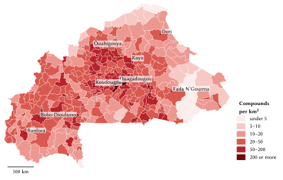
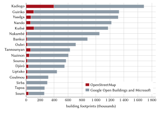
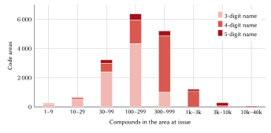
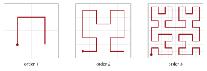
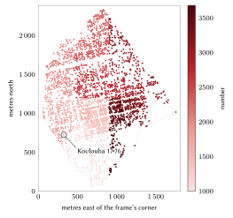
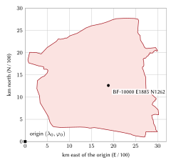

# Introduction

## The problem

An address does three things: it lets a visitor find a dwelling, it lets an institution refer to that dwelling in its records, and it lets the household prove where it lives. Burkina Faso has partial instruments for each of these functions but no instrument that serves all three for every household. La Poste Burkina Faso assigns a five-digit postcode to each commune and to delivery zones in the two largest cities [@upu2021bfa; @laposte_cp]. The communes of Ouagadougou and Bobo-Dioulasso have coded streets and are renumbering doors with the support of the Association des municipalités du Burkina Faso (AMB) and the European Union [@b24_2021; @sidwaya2023; @b24_2025]. The cadastre numbers parcels by section, îlot and parcelle [@decret2012_1006]. None of these reaches the compound, the unit at which most Burkinabè households live: a yard, walled or open, holding a main house, rooms, a kitchen and a granary behind one entrance.

The consequences are familiar to every resident. Deliveries end with a telephone call and a sequence of landmarks. A motorcycle taxi or an ambulance reaches the right quarter and then loses time in unnamed lanes. In the non-loti (unplanned) zones of Ouagadougou, which house more than 30 % of the city's residents [@afd2021], nothing is numbered. In villages, the round huts of a family compound stand among fields with no road between them. Families abroad send money and goods to compounds that have no written address.

## Contribution

This report describes an addressing model built for Burkina Faso and a registry issued with it. Its contributions are:

1. a code form, *name + number*, in which the name is a quarter or village name already in use and the number has at most five digits, and which is unique nationally without a commune or region attached (Section 4);
2. a numbering scheme, one frozen block per area within one national range per name, ordered along a Hilbert curve with reserved space, that keeps codes stable as the country grows (Sections 4.6–4.8);
3. a complete registry of 8,369,987 compounds, grouped from 13,318,641 building footprints, together with a normative specification, a reference engine, conformance vectors and a deployable server (Section 5);
4. measurements of the properties of the issued codes (Section 6) and a comparison with the alternatives we evaluated (Section 7);
5. estimates of the benefits for citizens, logistics, emergency services and government, each with its assumptions and a sensitivity range (Sections 8–11).

The model is designed to work beside the official systems, never against them. Where a commune has given an address, that address is shown first, exactly as the commune writes it; La Poste's postcode forms the first part of every machine code; cadastral references are kept as cross-references.

## Structure of the report

Section 2 reviews Burkina Faso's existing addressing, postal and land systems and the international literature. Section 3 describes the data. Section 4 sets out the model, rule by rule. Section 5 describes the implementation and Section 6 evaluates it. Section 7 discusses the designs we rejected. Sections 8 to 11 assess the benefits by sector. Section 12 covers privacy, safety and governance, Section 13 the limitations, and Section 14 concludes.

# Background and related work

## Country context

The fifth general census (RGPH 2019) counted 20,505,155 inhabitants in 3,908,847 households, a mean of 5.2 persons per household; 73.9 % lived in rural areas [@insd2022key]. Ouagadougou had 2,415,266 inhabitants and Bobo-Dioulasso 904,920 [@insd2022]. A reform adopted by the Council of Ministers on 2 July 2025 replaced the 13 regions and 45 provinces with 17 regions and 47 provinces under new names; the 351 communes, 49 urban and 302 rural, were not changed [@koaci2025]. The constitutional revision promulgated in January 2024 made the national languages official languages, with French and English as working languages [@b24_constitution]; Mooré, Dioula, Fulfulde and Gulmancema are each spoken by millions. Telephone numbers have eight digits and are read in pairs.

## Postcodes

The Universal Postal Union's addressing sheet for Burkina Faso places a five-digit postcode before the locality name, as in *10010 OUAGADOUGOU* [@upu2021bfa]. La Poste's own service describes the structure of the code: the first digit identifies the region, the first two the province, the third and fourth the quarter, commune, town or agency, and the fifth the type (0 for a commune or quarter, 1 to 8 for an agency) [@laposte_cp]. We collected the complete public table: 582 codes, comprising 351 commune codes, 122 quarter codes (66 quarter names in six zones of Ouagadougou and 56 in four zones of Bobo-Dioulasso) and 109 agency codes. The region digit still follows the regions in force before 2025. The postcode identifies a commune or a zone, never a street or a door, and the table is not published as open data. One commune, Komsilga (Kadiogo), has no entry in La Poste's table.

## Street codes and door numbers

Ouagadougou and Bobo-Dioulasso were first addressed in 1985 [@sidwaya2022]. The 2009 redistricting raised Ouagadougou from 30 to 55 secteurs and Bobo-Dioulasso from 25 to 33, which broke the earlier numbering. A street code combines the secteur number and an order number ("Rue 54.160"), and door numbers are metric, alternating between the two sides of the street. In November 2021 the AMB and the European Union launched a renewal of urban addressing in the two cities, intended to reference more than 16,000 streets and to number every dwelling free of charge [@b24_2021]. By October 2023 the Projet d'appui au système d'information urbaine (PASIU) reported more than 16,000 streets and 93,000 doors addressed [@sidwaya2023]; in April 2025 Ouagadougou extended the operation to arrondissements 5 and 12, covering more than 2,277 streets and 43,000 doors [@b24_2025]. We found no public lookup service and no open data for these addresses. In OpenStreetMap, 1,571 named streets of the two cities carry their communal code.

## Secteurs

Residents of the towns refer to their *secteur* ("secteur 15"), but no map of secteur boundaries is public. We found none in OpenStreetMap, on the Humanitarian Data Exchange or geoBoundaries (which hold communes only), or on the websites of the communes and of the Institut national de la statistique et de la démographie (INSD), which publishes lists of secteurs and their populations without boundaries. A code built on secteurs could therefore not be computed reproducibly, and a guessed boundary would place homes in the wrong secteur.

## Land parcels

Décret 2012-1006 numbers cadastral parcels by section, îlot and parcelle, in digits only [@decret2012_1006]. By 31 December 2022 the Direction générale des Impôts had digitised 434,274 of an estimated 1,263,068 parcels [@dgi2023], and in March 2025 it launched the SYC@D platform for cadastral and land procedures [@b24_sycad]. Parcels identify land rights rather than the point where a visitor arrives, and the non-loti zones have none. We use them only as cross-references.

## International practice

The UPU's S42 standard defines the components of postal addresses and templates for rendering them [@upu2017s42], and the UPU has argued that an address is a precondition for social and legal identity and for public services [@upu2012addressing]; its recent econometric analysis of postal data found that better address accuracy raises successful first delivery attempts by a median of 5.4 % across operators, and by up to 23 % [@upu2025brief]. The World Bank's review of street addressing in African cities documented programmes that named streets and numbered doors, at an average cost of US\$5.7 per doorway at 2005 prices, and found that addressing systems decay when residents do not use them [@farvacque2005]. UN-Habitat has emphasised the role of the street network in urban prosperity [@unhabitat2013]. These programmes presuppose streets; much of Burkina Faso's housing stock lies in villages and unplanned zones where the street is not a usable reference.

## Grid and word codes

Grid-based codes avoid streets altogether. Open Location Code (Plus Codes) encodes latitude and longitude in a base-20 alphabet, such as *7C4W9F7M+M89* [@olc]; what3words assigns three dictionary words to each 3 m square [@what3words]. In the region, Ghana's National Digital Property Addressing System, launched in 2017, assigns a code to every location from a national grid [@ghanapost2017]. Grid codes are precise and need no registry, but they identify a point rather than a dwelling, they change when the point chosen moves, and their alphabets are not words that residents use: Plus Codes require letters to be spelt aloud, which is error-prone in French and in the national languages, and word codes depend on a proprietary dictionary. Our design retains a grid code, the spot code of Section 4.11, for points that are not dwellings, but bases the address on names people already say.

## Design principles

From this review we derived ten principles, in order of priority:

1. people remember the code and obtain it without effort: a familiar name and at most five digits;
2. the code is unique nationally on its own, without commune, secteur or position;
3. the unit is the compound, and navigation ends at its gate;
4. an official address comes first wherever one exists;
5. the code cannot be mistaken for an official one: it starts with a name, so it never resembles a postcode, a street code ("15.123") or a parcel reference;
6. it works offline;
7. it is stable: a code never moves and is never reused;
8. it describes places, never people;
9. it is open and can be transferred to the State;
10. it is built for Burkina Faso's places, names and institutions.

# Data and sources

**Building footprints.** We combined 1,032,537 footprints from OpenStreetMap [@osm2026; @haklay2008] with footprints derived from satellite imagery by Google Open Buildings [@sirko2021; @openbuildings] and Microsoft [@msbuildings], distributed through Overture Maps [@overture], taking the imagery-derived footprint only where OpenStreetMap had none. The result is 13,318,641 footprints with a median area of 22.6 m². OpenStreetMap coverage is concentrated in Kadiogo, where it supplies 397,492 of 1,687,862 footprints; elsewhere the imagery-derived footprints dominate (Figure 2). The height attribute of the imagery-derived footprints is a rendering default and is not used.

**Places.** Code areas are seeded from OpenStreetMap place nodes (city, town, quarter, suburb, neighbourhood, village, hamlet, locality) and from GeoNames populated places [@geonames], which name quarters of Ouagadougou absent from OpenStreetMap, such as Dapoya, Larlé and Cissin.

**Administrative units.** Commune boundaries are OCHA's common operational dataset of 2025, with 17 regions, 47 provinces and 351 communes [@hdx2025]; Figure 1 shows the density of compounds by commune. Each commune was matched to its La Poste postcode: 294 by exact name, 55 by spelling variant (for example Goursi and *GOURCY*), one by hand (Thiou in Boulkiemdé, *THYOU 40850*); Komsilga, absent from La Poste's table, uses 10990, a code outside La Poste's series, until La Poste assigns one.

**National border.** The border of the country is OpenStreetMap's national boundary of Burkina Faso (`admin_level` 2) [@osm2026]. It decides where a code can exist, not the commune outlines: a building is coded only if its entrance lies inside the border or within 300 m of it, a margin for the accuracy of the line and for gates on it. Commune outlines and spot frames that reach over the border into a neighbouring country give no code there.

**Official streets.** The street codes of Ouagadougou and Bobo-Dioulasso are taken from OpenStreetMap, where 1,571 named streets carry them.

**Enclosures and gates.** Walls, fences and hedges mapped in OpenStreetMap (5,868 closed enclosures around buildings) and mapped gates are used to group buildings and to validate the grouping.

{width=100%}

{width=85%}

# The model

## Notation and the forms of a code

Throughout, $P$ denotes the plate name of an area, $N$ the number of a compound, $d \in \{3,4,5\}$ the number of digits of $N$, $C_5$ the five-digit postcode of the commune, $I_3$ the three-digit index of the area within its commune, $i_5$ the five-digit national index of the name, and $c$ the check digit. One code has several forms (Table 1).

| Form | Example | Used by |
|:------------|:----------------------|:--------------------|
| Remembered | **Koulouba 17 76**, said "Koulouba, dix-sept, soixante-seize" | people: spoken, typed, written on a parcel |
| Five digits | **Bobo 26 206**, said "vingt-six, deux cent six" | larger places: a pair and a hundred |
| Three digits | **Abanda 217**, said "deux cent dix-sept" | small villages |
| Machine | **BF-10000-V064-1776-9** | information systems; the last digit is the check |
| Structure, entrance | **BF-10000-V064-1776-9.2/1** | a building of the compound; one of its gates |
| Spot | **BF-10000 E1885 N1262** | any point: a stall, a field, a market place |
| Official | **Avenue Uemoa, Ouagadougou** | the commune's address, shown first where it exists |

: The forms of one code.

The remembered and machine forms are
$$
\text{remembered} = P \ \ \sigma(N), \qquad
\text{machine} = \texttt{BF-}C_5\texttt{-V}I_3\texttt{-}N\texttt{-}c,
\tag{1}
$$
in which the plate name and the number are separated by one space and $\sigma$ groups the digits as they are said: $\sigma(217) = 217$, $\sigma(1776) = 17\;76$, $\sigma(26206) = 26\;206$. A plate name never contains a digit, so the number always begins at the first digit of the text. The check digit $c$ (Section 4.10) appears only in the machine form; people never see, type or say it.

## Code areas

The machine form rests on the 351 communes and their postcodes. A *code area* is a named place within a commune: an OpenStreetMap place or a GeoNames populated place. A GeoNames place within 1 km of an OpenStreetMap place of the same name is treated as the same place, and a second place of one name within 300 m is dropped. This yields 17,518 areas, 7,117 of them seeded from GeoNames. Each footprint $f$ is assigned to the nearest place point $a$ of its own commune under a local equirectangular metric [@snyder1987]:
$$
\operatorname{area}(f) = \operatorname*{arg\,min}_{a \in \mathcal{A}(\operatorname{commune}(f))}
\Big[ (\lambda_f - \lambda_a)^2 \cos^2 \varphi_f + (\varphi_f - \varphi_a)^2 \Big],
\tag{2}
$$
where $\lambda$ and $\varphi$ are longitude and latitude and ties go to the lower area key. Of the 17,518 areas, 17,319 hold compounds. Ouagadougou has 159 areas with 755,775 compounds and Bobo-Dioulasso 72 areas with 247,757; the largest area, Samogan in Bobo-Dioulasso, holds 38,168 compounds. Figure 3 shows the distribution of area sizes. Each area is frozen at first issue: its key, its block of numbers and its *frame*, the bounding box of its footprints' centres over which its numbers are laid out.

{width=90%}

## Compounds

Footprints are grouped into compounds before any number is assigned, one area at a time, in a fixed order of their stable identifiers. Only footprints whose centre lies inside the national border are grouped, and a compound whose reference point lies more than 300 m outside the border receives no code, whatever commune outline holds it. Let $\operatorname{dist}(a,b)$ be the shortest distance between the outlines of footprints $a$ and $b$, zero when they touch or overlap. The rules, applied in order, are given in Table 2.

| Rule | Condition | Effect | Confidence |
|:--------|:-------------------------|:-----------------|---------:|
| Enclosure | the footprint's centre lies inside a mapped closed wall, fence or hedge of at most 6,000 m² | the enclosure is one compound | 0.85 |
| Annex | a footprint under 25 m² (kitchen, wash house, granary) | joins the nearest footprint of at least 25 m² with $\operatorname{dist} \le 8$ m | 0.60 |
| Hut cluster | outside Ouagadougou and Bobo-Dioulasso: huts under 40 m² belonging to no house, $\operatorname{dist} \le 3$ m | one compound of at most 25 huts | 0.50 |
| Single | anything else | its own compound | 0.40 |

: Rules for grouping footprints into compounds.

Only annexes join a house, and a hut cluster never joins two houses, so groups cannot chain across a neighbourhood. The 8 m annex distance reflects the width of Burkinabè yards. The result is 8,369,987 compounds, 1.59 footprints per compound: 5,374,878 single buildings, 2,218,591 houses with their annexes, 767,915 hut clusters and 8,603 enclosures. By size, 5,377,425 compounds have one structure, 1,842,263 two, 685,968 three and 464,331 four or more. Table 3 gives the counts by region.

| Region | Compounds | Footprints | Median footprint (m²) |
|:--|--:|--:|--:|
| Kadiogo | 1,120,464 | 1,687,862 | 28.3 |
| Guiriko | 880,516 | 1,330,983 | 26.2 |
| Nando | 748,195 | 1,222,489 | 20.5 |
| Yaadga | 729,231 | 1,318,518 | 21.7 |
| Kuilsé | 680,737 | 1,174,896 | 18.8 |
| Nakambé | 633,367 | 1,050,946 | 22.3 |
| Bankui | 566,039 | 879,268 | 24.7 |
| Oubri | 443,496 | 710,452 | 18.4 |
| Tannounyan | 395,808 | 628,139 | 22.6 |
| Djôrô | 391,464 | 549,894 | 27.1 |
| Nazinon | 370,589 | 605,364 | 18.0 |
| Sourou | 367,683 | 571,327 | 24.3 |
| Liptako | 304,605 | 442,333 | 22.6 |
| Goulmou | 204,651 | 317,352 | 19.6 |
| Sirba | 193,650 | 303,459 | 18.0 |
| Tapoa | 173,993 | 264,888 | 17.7 |
| Soum | 165,499 | 260,471 | 20.0 |
| **Burkina Faso** | **8,369,987** | **13,318,641** | **22.6** |

: Compounds and footprints by region.

## Plate names

The name in a code must be short enough to say, remember and paint on a gate. A name $s$ is admissible as a plate name if
$$
|\operatorname{NFC}(s)| \le 12, \qquad
\big|\operatorname{words}(s) \setminus L\big| \le 2, \qquad
s \text{ contains no digit},
\tag{3}
$$
where $|\cdot|$ counts characters after Unicode normalisation (an accented letter, a space, a hyphen or an apostrophe each count as one) and $L$ is the set of linking words that are not counted: de, du, des, d, la, le, les, l, et, sur, en, au, aux, à and n. A name that fails Eq. (3) is shortened by fixed steps, the first that succeeds being taken:

1. a documented short form in common use: the place nodes named Bobo-Dioulasso and Fada N'Gourma become *Bobo* and *Fada*;
2. cleaning: removing bracketed text and the generic words Q, Quartier, Cité, Lotissement, Zone, Secteur, Village de and Hameau ("Q Tangonkin" becomes *Tangonkin*);
3. abbreviating "Saint" to "St";
4. the most distinctive run of whole words, taken only when it is clearly ahead of the alternatives.

A word is never cut, and a qualifier that distinguishes a hamlet from its parent village (Peulh, Foulbé, Mossi, Yiri, Tenga, Naba) is never a name on its own. Where the short form would contain a digit, would be a bare generic word or would equal another town's short form, the area takes its commune's name provisionally and the choice is left to the commune. Two districts of Ouagadougou carry their name without its number: *Ouaga* for Ouaga 2000 and *Logements* for 1200 Logements; the full names remain aliases.

| Plate name derivation | Areas |
|:--|--:|
| Official name used unchanged | 14,557 |
| Cleaned | 1,767 |
| Shortened to its distinctive words | 242 |
| Named without its number | 4 |
| Documented short form | 2 |
| Abbreviated | 1 |
| Provisional, left to the commune | 945 |
| **Total** | **17,518** |

: How the plate names were derived.

Of the official names, 1,346 exceed 12 characters or two words. The 945 provisional names cover 387,212 codes; 270 of them still exceed the limit, mostly single long words. The official name remains an alias (805 aliases are kept; 8 are dropped because two plate names would claim them), so typing the full name finds the same compound.

## The name key

Names that are spelt differently but said the same must share one number range, or two areas would issue the same remembered code. The name key is the composition
$$
\kappa(s) = \operatorname{squeeze} \circ \operatorname{fold} \circ \operatorname{join} \circ \operatorname{article} \circ \operatorname{head} \circ \operatorname{saint} \circ \operatorname{upper} \circ \operatorname{unaccent}\,(s),
\tag{4}
$$
whose steps are given in Table 5.

| Step | Rule | Example |
|:----------|:---------------------------|:--------------------|
| unaccent, upper | accents and case removed | Douré → DOURE |
| saint, head, article | St, Ste → Saint, Sainte; a leading Q, Quartier, Hameau, Village de and le, la, les, l' removed | Q-Tanghin → TANGHIN |
| join | every character other than A–Z and 0–9 removed | Saint-Camille → SAINTCAMILLE |
| fold | tch → c, dj → j, gh → g, ph → f, ou → u, w → u, gu before i or e → g | Ouatinoma, Watinoma → UATINOMA; Tanguin, Tanghin, Tangin → TANGIN |
| squeeze | a doubled letter written once; digits never squeezed | Wattinooma → UATINOMA |

: The steps of the name key.

Folding can only merge spellings, never split one name in two; a false merge is harmless, because merged names still decode apart through their blocks (Section 4.6). The 17,518 areas carry 12,344 distinct name keys, of which 2,755 are shared by 7,929 areas. The most repeated are Natenga (74 areas), Boussouma (50), Douré (43), Tanghin (38) and Yargo (37).

## One national range per name

Every name key owns one national range of numbers with a fixed digit count $d$: 100–999, 1000–9999 or 10000–99999. Let the areas that share a key, in the frozen order of their keys (postcode, then area index), hold $n_1, \dots, n_k$ compounds at issue. Each area receives a block of
$$
B(n) = \max\!\Big(20,\; 10 \left\lceil \tfrac{2n}{10} \right\rceil\Big)
\tag{5}
$$
numbers, twice its compounds rounded up to whole tens. The name's total is $T = \sum_{j=1}^{k} B(n_j)$, and its digit count is the smallest $d$ that keeps the top tenth of the range spare:
$$
d = \min \big\{ d' \in \{3,4,5\} : T \le \lfloor 0.9 \cdot 9 \cdot 10^{d'-1} \rfloor \big\},
\tag{6}
$$
that is, $T \le 810$, $8\,100$ or $81\,000$. The blocks are laid end to end from $10^{d-1}$.

*Worked example: Koulouba.* One area of Ouagadougou with 2,683 compounds. Eq. (5) gives $B = 10\lceil 5366/10 \rceil = 5370$, so the block is 1000–6369. Since $810 < 5370 \le 8\,100$, Eq. (6) gives four digits, and 6370–9999 remain spare.

*Worked example: Bobo.* The central area of Bobo-Dioulasso has 20,007 compounds: $B = 40\,020$, the block is 10000–50019 and the name has five digits, with 50020–99999 spare.

*Worked example: Natenga.* The 74 areas named Natenga need $T = 19\,260$ numbers, more than 8,100, so the name has five digits and occupies 10000–29259, leaving 70,740 spare. *Natenga 10 016* lies in Pabré's block (10000–10269) and *Natenga 10 286* in Dapélogo's (10270–11319): the number alone identifies the place.

Figure 4 shows a shared four-digit name, Kombissiri, whose six areas fill 7,910 of the 8,100 numbers allowed, and the internal layout of Koulouba's block.

{width=100%}

| Digits | Areas | Compounds | Share of compounds |
|:--|--:|--:|--:|
| 3 | 8,477 | 1,301,260 | 15.5 % |
| 4 | 7,352 | 4,451,135 | 53.2 % |
| 5 | 1,490 | 2,617,592 | 31.3 % |

: Digits of the number, by area and by compound.

No name needs a qualifier and no area had to be split. The fullest shared range, Kaya's eleven areas, uses 69,550 of its 81,000 numbers, and the largest single area, Samogan, 76,340. A new area with an existing name, or an area whose block is full, takes the next block above all blocks of its name; blocks never move, shrink or get renumbered.

## Numbering within an area

Compounds are numbered along a Hilbert curve [@hilbert1891] laid over the area's frozen frame $(x_0, y_0, x_1, y_1)$, at each compound's reference point (the centre of its largest building until a gate is confirmed). The Hilbert curve preserves locality better than row-by-row or Z-order scans [@moon2001], so that neighbouring compounds receive neighbouring numbers (Figure 5). With $m = 16$ and $M = 2^m - 1 = 65\,535$, the integer grid coordinates are
$$
g_x = \min\!\Big(M, \Big\lfloor \frac{\lambda - x_0}{x_1 - x_0} M \Big\rfloor\Big), \qquad
g_y = \min\!\Big(M, \Big\lfloor \frac{\varphi - y_0}{y_1 - y_0} M \Big\rfloor\Big),
\tag{7}
$$
clamped below at zero. The curve position $h$ is computed by visiting the scales $s = 2^{m-1}, 2^{m-2}, \dots, 1$ in turn, with $h$ initially zero:
$$
r_x = \lfloor g_x / s \rfloor \bmod 2, \quad
r_y = \lfloor g_y / s \rfloor \bmod 2, \quad
h \leftarrow h + s^2 \big( (3 r_x) \oplus r_y \big),
\tag{8}
$$
where $\oplus$ is the bitwise exclusive or; after each step, if $r_y = 0$, the quadrant is reflected, $(g_x, g_y) \leftarrow (M - g_x, M - g_y)$ when $r_x = 1$, and the coordinates are then exchanged, $(g_x, g_y) \leftarrow (g_y, g_x)$.

{width=90%}

The $n$ compounds of an area whose block is $[F, F + B)$ are sorted by $(h, \text{stable identifier})$, and the $i$-th, counting from zero, receives
$$
N_i = F + i \cdot \delta, \qquad
\delta = \max\!\Big(1, \Big\lfloor \frac{\mu}{\lfloor 1.5\, n \rfloor} \Big\rfloor\Big), \qquad
\mu = \Big\lfloor \frac{2B}{3} \Big\rfloor,
\tag{9}
$$
so the numbers occupy the main part $[F, F + \mu)$, with gaps of $\delta - 1$ between neighbours for infill, and the *tail reserve* $[F + \mu, F + B)$ is left empty at first issue.

*Worked example: Koulouba 17 76.* The compound's reference point is $\varphi = 12.3641615$, $\lambda = -1.5166371$, and Koulouba's frame is
$$
(x_0, y_0, x_1, y_1) = (-1.519638,\ 12.357614,\ -1.502982,\ 12.379197).
$$

Eq. (7) then gives
$$
g_x = \Big\lfloor \frac{0.0030009}{0.016656} \cdot 65\,535 \Big\rfloor = 11\,807, \qquad
g_y = \Big\lfloor \frac{0.0065475}{0.021583} \cdot 65\,535 \Big\rfloor = 19\,880,
$$
and Eq. (8) gives $h = 906\,489\,237$, which ranks 777th of the 2,683 compounds along the curve ($i = 776$). With $B = 5370$, Eq. (9) gives $\mu = 3580$, $\delta = \max(1, \lfloor 3580 / 4024 \rfloor) = 1$, and $N = 1000 + 776 = 1776$; the tail reserve is 4580–6369. Figure 6 shows the result for the whole area.

{width=68%}

## New compounds

A compound built after issue is placed in the area of the nearest issued code within 250 m, else in the area containing the point, else in the nearest area. A point more than 300 m outside the national border receives no code, and no entrance is moved there. Let $a$ be the number of its predecessor on the curve (the last issued compound with $h$ at or before its own) and $b$ that of its successor. With $\Phi = \{ x \in (a, b) \cap [F, F+\mu) : x \text{ free} \}$ the free numbers of the main part strictly between them, it receives
$$
N^{*} =
\begin{cases}
\operatorname*{arg\,min}_{x \in \Phi} \big( |x - \tfrac{a+b}{2}|,\ x \big) & \text{if } \Phi \ne \varnothing,\\
\min \{ x \in [F + \mu, F + B) : x \text{ free} \} & \text{otherwise,}
\end{cases}
\tag{10}
$$
the free number closest to the midpoint (the lower one on ties), or failing that the lowest free number of the tail reserve; a full block takes an extension block of its name. In Koulouba $\delta = 1$, so a house built between two neighbours receives *Koulouba 45 80*, the first number of the tail reserve; where blocks are roomier, new homes take numbers between their neighbours. A number once issued is never reused.

## Decoding without context

A remembered code is read as a name followed by three to five digits, grouped or not. It decodes to
$$
\operatorname{decode}(P, N) = \big\{ a : \kappa(P) \in \{\kappa(a)\} \cup \operatorname{aliases}(a),\ \ |N| = d(\kappa(P)),\ \ N \in \operatorname{blocks}(a) \big\},
\tag{11}
$$
which by construction has at most one element. A number that falls in no block, in the spare of a name or with the wrong digit count is reported as not issued, never guessed. A secteur form ("Secteur 15 Ouaga · 48 217") is refused with the request to give the quarter or village and its number.

## The check digit

Information systems exchange the machine form, whose last digit is computed with Damm's algorithm over a totally anti-symmetric quasigroup of order 10 [@damm2004; @damm2007]. For the digit string $x_1 x_2 \dots x_\ell$,
$$
c_0 = 0, \qquad c_j = Q[c_{j-1}][x_j] \quad (j = 1, \dots, \ell), \qquad c = c_\ell,
\tag{12}
$$
where $Q$ is the table below and the checked string is $i_5 \,\Vert\, C_5 \,\Vert\, 2 \,\Vert\, I_3 \,\Vert\, N$: the name's national index on five digits, the postcode, the kind digit of an area code, the area index and the number.

| $Q$ | 0 | 1 | 2 | 3 | 4 | 5 | 6 | 7 | 8 | 9 |
|:-:|:-:|:-:|:-:|:-:|:-:|:-:|:-:|:-:|:-:|:-:|
| **0** | 0 | 3 | 1 | 7 | 5 | 9 | 8 | 6 | 4 | 2 |
| **1** | 7 | 0 | 9 | 2 | 1 | 5 | 4 | 8 | 6 | 3 |
| **2** | 4 | 2 | 0 | 6 | 8 | 7 | 1 | 3 | 5 | 9 |
| **3** | 1 | 7 | 5 | 0 | 9 | 8 | 3 | 4 | 2 | 6 |
| **4** | 6 | 1 | 2 | 3 | 0 | 4 | 5 | 9 | 7 | 8 |
| **5** | 3 | 6 | 7 | 4 | 2 | 0 | 9 | 5 | 8 | 1 |
| **6** | 5 | 8 | 6 | 9 | 7 | 2 | 0 | 1 | 3 | 4 |
| **7** | 8 | 9 | 4 | 5 | 3 | 6 | 2 | 0 | 1 | 7 |
| **8** | 9 | 4 | 3 | 8 | 6 | 1 | 7 | 2 | 0 | 5 |
| **9** | 2 | 5 | 8 | 1 | 4 | 3 | 6 | 7 | 9 | 0 |

: Damm's quasigroup table $Q$ (row: interim digit $c_{j-1}$; column: next digit $x_j$).

*Worked example.* Koulouba's national index is 5572, its postcode 10000 and its area index 064, so the checked string is 05572 10000 2 064 1776. The interim digits $c_1, \dots, c_{18}$ are 0, 9, 3, 4, 2, 2, 4, 6, 5, 3, 5, 3, 3, 9, 5, 5, 5, 9, so $c = 9$ and the machine form is BF-10000-V064-1776-9. Replacing 1776 by the transposition 1767 gives the check 7, and by the single error 1777 the check 5; both are rejected. Because the name's index, the commune and the area enter the check, a number moved to another area of the same name fails both the check and the block test.

## Spot codes

Any point, including one that is not a dwelling, has a spot code: the commune's postcode followed by its distance east and north of the commune's frozen origin $(\lambda_0, \varphi_0)$ in units of 10 m, on four digits per axis (five where the commune is wider than 99.99 km). With $\varphi_c$ the commune's reference latitude,
$$
\begin{aligned}
k_x &= 111\,320 \cos \varphi_c, & k_y &= 110\,574,\\
E &= \Big\lfloor \frac{(\lambda - \lambda_0)\, k_x}{10} \Big\rfloor, & N_s &= \Big\lfloor \frac{(\varphi - \varphi_0)\, k_y}{10} \Big\rfloor,
\end{aligned}
\tag{13}
$$
where $k_x$ and $k_y$ are metres per degree of longitude and latitude. The code is decoded to the centre of its 10 m cell, so the decoding error is bounded by half the cell diagonal:
$$
\varepsilon \le \tfrac{1}{2} \sqrt{10^2 + 10^2} \approx 7.07 \text{ m}.
\tag{14}
$$

*Worked example.* For the point of Koulouba 17 76 in Ouagadougou's frame ($\lambda_0 = -1.69$, $\varphi_0 = 12.25$, $\varphi_c = 12.38$): $k_x = 111\,320 \cos 12.38^\circ = 108\,731.5$, $E = \lfloor 0.1733629 \cdot 108\,731.5 / 10 \rfloor = \lfloor 1885.00 \rfloor = 1885$ and $N_s = \lfloor 0.1141615 \cdot 110\,574 / 10 \rfloor = \lfloor 1262.33 \rfloor = 1262$, giving BF-10000 E1885 N1262 (Figure 7). Burkina Faso spans two UTM zones, which is why each commune has its own local frame rather than a national projected grid. Of the 351 frames, 346 fit four digits on both axes.

{width=55%}

*Points in no outline.* The published commune outlines are simplified and do not tile the country exactly: 9,235 issued entrances (0.11 %, in 110 communes) lie in a gap between two outlines or just over a border line. Frames never move, so such a point is coded in the frame of one commune, chosen among the candidates $\mathcal{C}$: the communes whose outline lies within 10 km of the point and whose frame the point lies at most 300 cells (3,000 m) beyond. Comparing in this order,
$$
c^\ast = \operatorname*{arg\,min}_{c \in \mathcal{C}} \big( h_c,\; d_c,\; p_c \big),
$$
where $h_c$ is 0 when the frame of $c$ holds the point and 1 otherwise, $d_c$ is the distance from the point to the nearest edge of the outline of $c$ with longitude differences scaled by $\cos \varphi$ (a fixed polynomial, so that every port chooses the same commune), and $p_c$ the postcode, which breaks ties. A point beyond the frame of $c^\ast$ takes its nearest edge cell, $E$ and $N_s$ clamped to $[0, 10^{k} - 1]$ for $k$ digits; a point with no candidate is refused. A spot code is a grid reference: a point just beyond the border can have one, but never a compound code. Both limits cover the registry with a margin: the farthest issued entrance lies 8.57 km from an outline, and the farthest edge cell 140 m beyond its frame. Of the 9,235 entrances, 9,227 are coded in a frame that holds them, within the bound of Eq. (14), and 8 at an edge cell, decoded at most 140 m away; the registry keeps the exact entrance beside the code. Decoding uses the frame of the commune the code names, which can differ from the commune of the compound's code.

*Worked example.* The entrance of BF-10000-V076-11657-0, a compound of Ouagadougou, lies in the gap between the outlines of Ouagadougou (5.1 m away) and Komsilga (0.7 m). Both frames hold it, so Komsilga's nearer outline gives BF-10990 E2012 N2633. The entrance of Tangassoko 23 02 (BF-32250-V024-2302-1), at 10.9987819 N, −0.9736617, lies 236 m from the outline of Tiebele and south of every frame within 10 km. In Tiebele's frame ($\varphi_0 = 11.00$), $N_s = \lfloor (10.9987819 - 11.00) \cdot 110\,574 / 10 \rfloor = -14$, 14 cells beyond, so it takes the edge cell $N_s = 0$: BF-32250 E1052 N0000.

## Building profile

Every structure carries a use class with its confidence and source, its size, its floor count where known and a status. The classes are residential (family yard, villa, rented rooms, apartment building, round hut, granary), commercial (shop, kiosk, market), office, government, education, health, religious, industrial, hospitality, transport, agricultural, annex, under construction and ruin. Classes are inferred in a fixed order of evidence: the OpenStreetMap building type (confidence 0.85), a shop, amenity or office tag on the footprint (0.75), a mapped place inside the footprint (0.65), the footprint's size (0.30–0.40), and otherwise residential by default (0.45). In practice 13,276,492 structures are residential, almost all by default; 18,187 are annexes, 7,081 educational, 5,610 commercial, 4,370 under construction, 2,872 religious, 1,435 health and 1,103 offices. OpenStreetMap gives a floor count for 511 buildings. A dwelling never carries a name.

## The official address first

Where the State or a commune has given an address, it is shown first, exactly as written. In Ouagadougou and Bobo-Dioulasso the official street within 30 m of the compound is shown on 143,381 compounds ("Avenue Uemoa, Ouagadougou"). A door number of the communal plan, once known from communal data or read from the plate by residents, replaces the street. The N-Ways code never changes and sits beside the official address, serving telephone use and distinguishing the households of one yard. Everywhere else no official address exists at door level and the N-Ways code is the address.

# Implementation

## Specification and reference engine

The normative specification (`engine/SPEC.md`) defines every rule above. The reference engine (`engine/reference/bf_engine.py` and `plate_names.py`) implements it in the Python standard library: name keys, plate names, check digits, the machine and remembered forms, spot codes, commune lookup, compound grouping, Hilbert ordering and numbering. It ships the frozen register of areas (`engine/data/register.json`) and the commune outlines, so a decoder needs no network connection.

## Conformance vectors

Any port of the engine must reproduce `engine/reference/vectors.json`: 722 name keys, 500 remembered and machine forms, 2,394 decodings of real codes, 700 spot codes, 621 points in no commune outline, five Hilbert positions, six grouping cases and a numbering scenario of 41 compounds of Samogan followed by 60 insertions by Eq. (10). A second file, `test_vectors.json`, covers check digits, rejected inputs, spoken French forms and plate names.

## The registry

The registry (`registry/`) publishes every issued code, with nothing withheld: one gzip-compressed CSV file per commune (351 files), the frozen area table `areas.csv.gz` and `MANIFEST.json`, which gives the count and the SHA-256 digest of each uncompressed file. Each row carries the machine, remembered and written forms, the area, the number and check, status and issue time, the entrance point and its kind, the spot code, the official address where one exists, and the building profile (class, use, kind, number of structures, floor area, grouping rule). It carries no personal data (Section 12).

## Server and API

The `server/` directory contains a deployable HTTP service, written in the Python standard library and reusing the reference engine. Its import step verifies every file's digest and count against the manifest, builds an SQLite database with indexes and a spatial index, and refuses any mismatch; its export step writes the registry back, and an export after import is byte-identical to the published files once uncompressed. The JSON API under `/v1` answers lookups by machine code, by remembered form (in any spacing, case or accentuation), by official address and by spot code; returns the compound at a point and the codes near it; validates codes; encodes and decodes spot codes; and lists zones and areas. A deployment designated as the issuer can issue codes for new compounds and other doors by the rules of Section 4.8: no code within 3 m of an existing one, outlines between 6 m² and 2 ha, other doors within 80 m, and the area of the nearest code within 250 m; nothing more than 300 m outside the national border. A container image makes `docker compose up` the entire deployment. The API is documented with real responses in `docs/api.md` and as an OpenAPI 3.1 description.

## Parity with the issuer

We checked that the server issues exactly what the N-Ways issuer issues. A replay of 105 issuing steps, covering doors that fill a block, its tail reserve and an extension block, gave identical numbers, machine and written forms, spot codes and blocks at every step; the 60 insertion vectors are part of the server's tests. On the full registry, 50 randomly drawn codes matched the N-Ways service on all 21 fields compared.

# Evaluation

We measured the issued registry with the published engine and the evaluation script of the repository, `tools/paper-evaluation.py`. Table 8 summarises the results.

**Uniqueness and collisions avoided.** The 3,694,477 codes whose name is shared by more than one area are the codes at risk of ambiguity. Had each area numbered its own range from $10^{d-1}$ with the same block and step rules, 1,600,311 of them (43.3 %) would have shared their remembered form with a code in another area of the same name. Under national ranges the number is zero by construction.

**Error detection.** The detection rates agree with the theory of Damm's quasigroup: all single-digit substitutions and all adjacent transpositions are detected [@damm2007], the two error classes that dominate in manual transcription of decimal codes [@verhoeff1969]; twin errors and jump transpositions, which are rarer, are detected in about nine cases out of ten.

**Length.** The digit counts are those of Table 6. A number of at most five digits lies within the span of short-term memory reported in the psychological literature, which places it near four chunks for unrelated items [@miller1956; @cowan2001]; grouping a five-digit number as a pair and a hundred makes it two or three chunks.

| Property | Measurement |
|:--------------|:------------------------------|
| Codes issued | 8,369,987 compounds, from 13,318,641 footprints; 17,319 of 17,518 areas hold codes |
| Uniqueness of machine codes | 8,369,987 distinct |
| Uniqueness of remembered forms | 8,369,987 distinct (by name key and number) |
| Number length | 3 digits: 15.5 %; 4 digits: 53.2 %; 5 digits: 31.3 %; none longer |
| Length of the written form | median 13 characters, 99th percentile 19, maximum 23; 91.6 % at most 16 |
| Decoding without context | 20,000 of 20,000 sampled codes decoded to their machine form, as written, in lower case without accents, and without the space in the number |
| Single-digit errors detected | 344,655 of 344,655 (100 %) |
| Adjacent transpositions detected | 30,453 of 30,453 (100 %) |
| Twin errors detected ($aa \to bb$) | 47,208 of 52,578 (89.8 %) |
| Jump transpositions detected ($abc \to cba$) | 25,097 of 28,264 (88.8 %) |
| Spot code decoding error | at most 7.04 m in a frame, over 20,000 sampled entrances (bound 7.07 m, Eq. (14)) |
| Ambiguity avoided by national ranges | 1,600,311 codes would collide if each area numbered its own range |

: Measured properties of the issued registry. The error-detection rates are computed over every possible error of 2,000 sampled machine codes.

**Compound grouping.** We re-ran the grouping rules while hiding the 5,868 mapped walls, fences and hedges, and compared the result with the enclosures: 11.7 % of enclosures are recovered whole, 9.7 % exactly, and a further 35.9 % miss only one building. Behind a Burkinabè wall, the main house, the rooms and the kitchen are usually separate buildings, and without a mapped wall the rules keep them apart deliberately: merging two codes later costs nothing, whereas splitting a wrong merge would give a household a new code. Residents' confirmations in the app ("these buildings are one home", "here is the gate") correct the remainder.

**Coverage of spot codes.** Every code has a spot code. The 9,235 entrances (0.11 %, in 110 communes) in no published commune outline are coded by the rule of Section 4.11; 8 of them take a frame's nearest edge cell, at most 139.7 m away.

**Worked examples on real codes.** Table 9 lists the compound nearest to well-known places.

| Near | Code | Machine form | Spot code |
|:--------------|:--------------|:------------------------|:------------------|
| Ouagadougou airport | Koulouba 17 76 | BF-10000-V064-1776-9 | BF-10000 E1885 N1262 |
| Gare routière de l'Est, Ouagadougou | Wayalguin 13 21 | BF-10000-V136-1321-4 | BF-10000 E2318 N1563 |
| Rood-Woko market, Ouagadougou | Ouagadougou 31 493 | BF-10000-V089-31493-6 | BF-10000 E1811 N1309 |
| Ouaga 2000 shopping centre | Caisse 13 63 | BF-10000-V026-1363-8 | BF-10000 E1771 N0623 |
| Grand Marché, Bobo-Dioulasso | Bobo 26 206 | BF-90000-V006-26206-1 | BF-90000 E3164 N2624 |
| Koudougou cathedral | Koudougou 11 485 | BF-40000-V019-11485-8 | BF-40000 E1596 N1381 |
| Ouahigouya cathedral | Ouahigouya 13 699 | BF-55000-V032-13699-9 | BF-55000 E1413 N1630 |
| Kaya museum | Kaya 34 752 | BF-50000-V051-34752-0 | BF-50000 E2851 N0912 |
| Banfora cathedral | Banfora 15 450 | BF-94000-V001-15450-3 | BF-94000 E2346 N2908 |
| Fada N'Gourma market | Fada 12 600 | BF-75000-V019-12600-7 | BF-75000 E2933 N5881 |
| Dédougou central market | Dédougou 14 323 | BF-80000-V013-14323-8 | BF-80000 E3041 N2576 |
| Koupéla cathedral | Koupéla 20 158 | BF-72000-V021-20158-4 | BF-72000 E0940 N1694 |
| Gaoua cathedral | Gaoua 22 319 | BF-96000-V033-22319-6 | BF-96000 E2156 N1742 |
| Dori cathedral | Dori 14 311 | BF-60000-V042-14311-7 | BF-60000 E4054 N3171 |

: Real codes of the registry: the compound nearest to well-known places. For the first two, the official street is shown first (Avenue Uemoa; Avenue Pape Jean Paul II).

Four scenarios illustrate the behaviour of the system. *On the telephone*, a motorcycle-taxi driver is told "Koulouba, dix-sept, soixante-seize", types `koulouba 1776`, and is shown the compound, Avenue Uemoa and the gate. *With a shared name*, `natenga 10016` falls in Pabré's block and `natenga 10286` in Dapélogo's, with nothing to choose from a list. *With a transcription error*, a partner's system receiving BF-10000-V064-1767-9 rejects it, because the check of 1767 is not 9. *With a secteur form*, `Secteur 15 Ouaga 48217` is refused with a request for the quarter, since no secteur map exists against which to check it.

# Designs considered and rejected

## Capacity arithmetic

Before issue we estimated the number of compounds at 0.546 per structure, the ratio measured in Ouagadougou, or about 7.3 million nationally; the count at issue is 8,369,987. The capacity rule requires at least two numbers per compound. Table 10 compares the forms we evaluated against this rule.

| Option | Example | Arithmetic | Outcome |
|:-----------|:-------------|:---------------|:--------------|
| National digits only | 48173052 | $8.37\,\text{M} \times 2 = 16.7\,\text{M}$, 8 digits | too long; conveys no place |
| Commune and digits | 10000 · 1 538 004 | Ouagadougou $\approx 756\,000 \times 2$, 7 digits | too long |
| Postcode zone and digits | 10040 · 482 173 | Ouagadougou zones $\approx 126\,000$ compounds, 6 digits | zone codes are not words people say |
| Commune and letters | Ouaga 7HQ2X | $20^5 = 3.2\,\text{M}$ | letters must be learnt and spelt; poor for people who read little |
| Secteur and digits | Secteur 15 Ouaga · 48 217 | a mean Ouagadougou secteur $\approx 13\,700$ compounds, 5 digits | no secteur map exists (Section 2.4) |
| Plus Code | 7C4W9F7M+M89 | global grid, 10–11 characters | letters and a plus sign; hard to dictate |
| Each area its own range | Natenga 217 (×74) | Section 6: 1,600,311 ambiguous codes | not unique without a commune |
| **Quarter or village and a number from a national range** | **Koulouba 17 76** | every one of 17,518 areas fits 5 digits | **adopted** |

: Code forms evaluated against the capacity rule.

## Secteurs

The first design coded towns by secteur, with the town as part of the code ("Secteur 15 Ouaga · 48 217"), because townspeople name their secteur. Every urban commune numbers its secteurs from 1, so a shared range for "Secteur 1" cannot fit five digits; the town word must be part of the code. The design was abandoned because no secteur map is public: a code area that cannot be drawn reproducibly cannot be audited. Towns are instead coded by their named quarters, like villages, and secteur names will become aliases once communes share their maps.

## Qualifiers instead of national ranges

Letting the telephone's position, or a commune named after a comma ("Bissiga 217, Sabou"), distinguish places of the same name was also rejected. A code said on the telephone to a courier in another town, or written on a form, carries no position, and a commune after a comma is the first element people omit. Commune qualifiers remain the fallback for a name whose areas no longer fit five digits; at issue, no name needed one.

## No code where an official address exists

An earlier variant assigned no N-Ways number where a commune had numbered the door. We replaced it with one code for every dwelling, the official address shown first, so that a single form of address works in every commune and the households of one yard can be told apart.

## Other choices

*At most five digits.* A sixth digit makes a code longer than people reliably repeat after one hearing; every area fits five, the largest using 76,340 of 81,000 numbers. *Hilbert rather than Z-order.* The Hilbert curve has better clustering [@moon2001], so a street segment or a cluster of yards receives a narrower span of numbers. *Damm rather than a modulus-11 check.* A check character that detects all single errors and adjacent transpositions needs either eleven symbols with a prime modulus, which introduces a letter, or a quasigroup such as Damm's, which stays within the decimal digits [@verhoeff1969; @damm2007]. *Validated names.* A first pass derived "Dioulasso" for central Bobo-Dioulasso and "Secteur" for several quarters, and merged "2000" with "20" in name keys; the rules of Sections 4.4 and 4.5 correct these cases. After the first issue and before any code was confirmed, Ouaga 2000 became *Ouaga* and 1200 Logements *Logements*, and their codes were reissued under the new names; the registry holds only the reissued codes.

# Benefits for citizens

For a family in a yard of Wayalguin, on a non-loti plot at the edge of Ouagadougou or in a village of the Boucle du Mouhoun, a code changes four ordinary things: being found, proving where one lives, receiving goods and services, and doing so without cost or paperwork. Each household's code already exists; the app's "Get my code" shows it in one step, and no document or personal data is required. The code is not a land title, a permis urbain d'habiter or an attestation d'attribution.

**Estimate: households without a door-level address.** Let $C$ be the number of compounds, $S$ the compounds within 30 m of an official street, and $D$ the doors renumbered by the communal programmes. The share of compounds with no door-level official address satisfies
$$
1 - \frac{S + D}{C} \;\le\; u \;\le\; 1 - \frac{S}{C},
\tag{15}
$$
the lower bound assuming that renumbered doors and street-side compounds never coincide, the upper bound that they always do. With $C = 8\,369\,987$, $S = 143\,381$ and $D \approx 136\,000$ (93,000 doors by 2023 and 43,000 in 2025 [@sidwaya2023; @b24_2025]), $0.967 \le u \le 0.983$. Assuming that people are distributed across compounds in proportion to their number, this corresponds to 19.8 to 20.2 million of the 20.5 million people counted in 2019; because urban compounds hold more people than rural ones, the true figure is probably near the lower end. Each of them now has an address that can be written on a form and checked.

**Who benefits most.** The people with least today: residents of non-loti zones, of villages far from main roads and of rural hut compounds; tenants who share one gate; and those who do not read French easily, for whom a familiar place name and a few digits are easier than a street name.

# Benefits for logistics and commerce

Delivery in Burkina Faso relies on the telephone and the motorcycle. The UPU's analysis of postal operators found that better address accuracy raises successful first delivery attempts by a median of 5.4 % and by up to 23 % [@upu2025brief], and industry estimates put the average cost of a last-mile delivery attempt in Africa at about US\$2.70, with first-attempt success as low as 60 % for many couriers [@nextbillion2023].

**Estimate: avoided delivery attempts.** For $V$ deliveries, an improvement $\Delta R$ in the first-attempt success rate and a cost $c$ per attempt, the avoided cost is
$$
S = V \cdot \Delta R \cdot c.
\tag{16}
$$

With $V = 1000$, $c = \text{US}\$2.70$ and $\Delta R$ between the UPU's median and best observed effects, Table 11 gives the sensitivity range.

| $\Delta R$ | Basis | Saving per 1,000 deliveries |
|:--|:--|--:|
| 0.054 | UPU median effect | US\$146 |
| 0.10 | intermediate | US\$270 |
| 0.23 | UPU best observed effect | US\$621 |

: Sensitivity of Eq. (16) to the improvement in first-attempt success.

These effects were measured on postal networks, not in Burkina Faso, and the UPU also observed operators whose results worsened when addresses were handled poorly; the measurement plan of Section 13 is designed to replace these assumptions with local data.

**What the code provides to a business.** A stable key for every customer (the machine form), routing to the gate, input checked at entry by the check digit, and offline resolution: the engine and the area table are open, so any business can resolve codes in its own systems without charge. Goods reach Burkina Faso by road and rail from the coastal ports; importers, hauliers and the traders of Rood-Woko and Bobo-Dioulasso's Grand Marché can send goods and payments to a compound by code, and a cotton, sesame or shea cooperative can list its members' compounds by code rather than by village alone. Every machine code already begins with La Poste's postcode, so La Poste can deliver to a gate.

# Benefits for emergency services

An ambulance, a fire crew or a police patrol faces the courier's problem with more at stake. A qualitative study of emergency medical services in Rwanda found that crews and dispatchers lost time locating patients because they depended on local knowledge and needed several calls to establish a location [@hunt2023]. Burkina Faso's emergency numbers, 17 for the police and 18 for the fire brigade [@gac_bf], receive locations in the same way; we know of no published measurement of the time spent locating callers, which is itself a reason to begin measuring it.

With a code, the caller says one phrase ("Natenga, dix mille deux cent quatre-vingt-six"); the registry returns one compound, in Dapélogo, not one of the 73 other places called Natenga; the dispatcher reads back the place, its commune and its gate; and the crew drives to the gate. A spot code marks any point without a compound, such as a crash on a national road. All of this works offline.

**Estimate: survival after cardiac arrest.** Larsen and colleagues modelled survival after out-of-hospital cardiac arrest as 67 % less 2.3 percentage points per minute before cardiopulmonary resuscitation, 1.1 per minute before defibrillation and 2.1 per minute before advanced care [@larsen1993]. Where one crew brings all three, a reduction $\Delta t$ in the time to reach the patient raises survival by
$$
\Delta S = (2.3 + 1.1 + 2.1)\,\Delta t = 5.5\,\Delta t \ \text{percentage points}.
\tag{17}
$$

| $\Delta t$ (minutes) | 1 | 2 | 5 |
|:--|--:|--:|--:|
| $\Delta S$ (points) | 5.5 | 11.0 | 27.5 |

: Sensitivity of Eq. (17) to the time saved in locating the patient.

The model was fitted to a North American population with its own response system, and the evidence that response time affects survival in other conditions is mixed [@pons2005]. The figures are therefore orders of magnitude for Burkina Faso, not predictions.

# Benefits for government coordination and planning

A code is a shared key. When ministries, communes, utilities and INSD refer to a compound by the same code, their records can be joined without matching names and descriptions.

**One reference for all services.** An address directory provides a list of premises more complete than a tax roll and reveals who is missing from it [@farvacque2005]. In Ouagadougou and Bobo-Dioulasso the registry and the communal door numbers can be compared gate by gate once the latter are shared; the communes and the AMB can start from a registry of 8,369,987 compounds, each with a position and a code.

**A code that outlives reforms.** Regions and provinces were renamed in 2025 and are not part of the code. Communes are looked up from a compound's position, and a secteur map, once shared, becomes a set of aliases. When a boundary moves, every code continues to work.

**The non-loti zones.** A code exists before any lotissement. When a zone is subdivided, the new parcels can be linked to the codes already in use, and families keep the address their contacts know.

**The census.** The United Nations recommends that population censuses rest on a complete frame of dwellings with their locations [@un2017census]. A table linking codes to INSD's enumeration areas would give the next census a frame of 8,369,987 compounds from which to sample and to which enumerators can return, without storing any name.

**Estimate: the cost of a conventional programme.** Conventional addressing cost an average of $c_a = \text{US}\$5.7$ per doorway at 2005 prices [@farvacque2005]. Covering the same compounds would cost
$$
K = C \cdot c_a = 8\,369\,987 \times 5.7 \approx \text{US}\$47.7 \text{ million (2005 prices)}.
\tag{18}
$$

With $c_a$ varied by half in either direction, $K$ lies between US\$23.9 and US\$71.6 million. The registry does not replace street naming and door plates, which remain the communes' prerogative, but it provides the inventory such a programme needs and an address for every dwelling in the meantime.

**Access to services.** For a random sample of 20,000 compounds we computed straight-line distances to the nearest mapped facility (Table 13).

| Facility | Within 2 km | Within 5 km | Median distance |
|:--|--:|--:|--:|
| Health facility | 28.3 % | 46.8 % | 5.8 km |
| School | 39.4 % | 52.0 % | 4.4 km |
| Police | 8.6 % | 19.1 % | 21.8 km |
| Pharmacy | 12.2 % | 21.2 % | 25.5 km |

: Distance from 20,000 sampled compounds to the nearest mapped facility.

These figures describe the map as much as the country: health posts (CSPS) and police stations are thinly mapped. A ministry can replace the facility list with its own and recompute the table in minutes.

# Privacy, safety and governance

**Places, not people.** Codes describe places. Dwellings carry no names and no occupant data; businesses and public buildings carry their public names. Photographs taken when a resident adds a home are kept for verification only, and a household can ask for its gate to be hidden. No identity number is collected. Loi n° 001-2021/AN on the protection of personal data applies [@sidwaya2021data], with the Commission de l'Informatique et des Libertés (CIL) as the supervisory authority [@cil]; N-WAYS LIMITED files with the CIL the prior declaration that the law requires for the personal data its app processes (telephone numbers and photographs).

**What the registry publishes.** The open registry publishes every issued code: its area, entrance point, spot code, official address where one exists, and building profile. It never contains a name, a telephone number, a household size, a gate photograph, an outline drawn by a resident or the identity of anyone who confirmed a code, and sites for displaced people are never published. The United Kingdom's travel advice recommends against all travel to Burkina Faso [@fcdo2025]; the area table marks the areas concerned, as context for services that plan visits. An address is neither a land title nor an eviction list: information that residents provide about a compound is released only on a court order, with a public report.

**Confirmation.** Every code starts as provisional. It is confirmed when residents agree in the app: two telephones, at least one at the gate, and a majority of answers in agreement. No code is reviewed by hand.

**One issuer.** Areas, blocks and frames are frozen, codes never move, and regrouping never changes an issued code. Issuing must be done by a single issuer for the country, because two issuers working from the same registry would assign the same free number to two different compounds. A deployment of the server therefore issues only if the State or N-WAYS LIMITED has designated it as the issuer; every other deployment is read-only. A commune may rename an area (the old name remains an alias), choose a provisional plate name once, or add areas. The communes' addresses remain theirs: they are shown as written, never edited, and any discrepancy observed on the ground is reported to the commune. The repository can be transferred to the State or a body it designates, under the open licences, without forking the engine.

# Limitations and future work

- **Areas.** OpenStreetMap and GeoNames places are uneven; names and spellings need confirmation by residents and communes, and towns mapped with a single point form large areas with five-digit numbers.
- **Provisional names.** 945 plate names are provisional until the communes choose, and 270 of them still exceed the length limit.
- **Compounds are inferred.** Few walls are mapped; most compounds are single buildings or a house with its annexes, as the validation in Section 6 shows.
- **Building use.** Uses are mostly a default and floor counts almost always unknown.
- **Gates.** Most codes lead to the main building until a gate is confirmed.
- **Door numbers.** Until the communes share their data, a coded street shows its street name, and the door number only where residents confirm it.
- **Entrances, not outlines.** The published registry gives one entrance point per compound, not building outlines, so a deployment of the server measures its point and duplicate checks to entrances; on 40 test points within 8 m of a code, its answer agreed with the N-Ways issuer's, which uses outlines, in 33 cases and named a neighbouring compound in the other 7.
- **Spot codes.** 0.11 % of entrances lie outside the published commune outlines; their spot code can name a neighbouring commune's frame, and for 8 of them it names the nearest edge cell of a frame, up to 140 m away, while the registry keeps the exact entrance.
- **Places, not occupancy.** The registry records where a compound and its gate are, not who lives there or whether the compound is inhabited.
- **Scope.** Codes are unique within Burkina Faso; services show the country on every card.

Table 14 sets out the measurements we will make to test the model's assumptions in use.

| Measure | Method | Target |
|:---------------|:-----------------|:----------|
| Recall of one's own code after one week | residents asked without the app, in French, Mooré and Dioula | at least 80 % exact |
| Digit errors when dictating a code by telephone | recorded calls with partner couriers | under 5 % |
| First-attempt delivery success | partner couriers, with and without a code | at least 20 points higher |
| Time from arrival in the quarter to the gate | courier application timestamps | halved |
| Gates confirmed, door numbers attached | residents and couriers | 50,000 |

: Planned field measurements.

Future work includes the communal door numbers and secteur maps, to be requested from the communes and the AMB; confirmation of the postcode table and of Komsilga's code with La Poste; the choice of the 945 provisional names by the communes; and the tracing of gates with couriers.

# Conclusion

Burkina Faso's existing systems identify communes, streets in parts of two cities, and parcels, but not the compounds in which most households live. The model described here gives each of 8,369,987 compounds a code formed from a name residents already use and a number of at most five digits, unique nationally because every name draws frozen blocks from one national range. The rules are simple enough to state as a short series of formulas, and the measurements show that they hold on the full registry: every code is unique, every single error and adjacent transposition in a machine code is detected, and no number exceeds five digits. Because the specification, the engine, the complete registry and a deployable server are open, the State, La Poste, the communes or any developer can verify the codes, reproduce them and serve them, and the system can be transferred to a public body without loss.

# Data and code availability {-}

The specification, reference engine, conformance vectors, complete registry, server, figures and the sources of this report are available at <https://github.com/n-ways/open-addresses-burkina-faso> [@nways_repo]. Code is licensed under the Apache License 2.0; the registry, model and engine data under the Open Database License 1.0; documents under CC BY 4.0. Credit every use as "N-Ways Addressing for Burkina Faso, © N-WAYS LIMITED (nways.ng)".

# Acknowledgements {-}

The registry is derived from OpenStreetMap (© OpenStreetMap contributors, ODbL), GeoNames (CC BY 4.0), Google Open Buildings (CC BY 4.0), Microsoft building footprints (ODbL) distributed through Overture Maps, and OCHA's commune boundaries (CC BY-IGO). Commune numbers are La Poste Burkina Faso's postcodes. We thank the contributors to these datasets, whose work makes an open national registry possible.

# References {-}

::: {#refs}
:::
